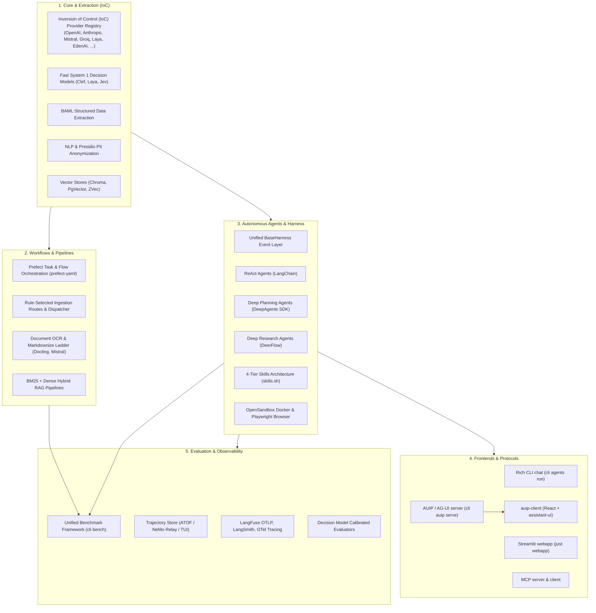

# GenAI Toolkit (`genai-tk`)

[](https://deepwiki.com/tclatos/genai-tk)

A comprehensive framework and developer toolkit for building enterprise GenAI, GraphRAG, and Autonomous Agentic applications with LangChain, DeepAgents, DeerFlow, Prefect, and 100+ LLM providers.


---

## Core Domains & Pillars

The toolkit is organized around complementary, composable domains:



---

## Installation

Get up and running with `genai-tk` in minutes.

### Quickstart 

```bash
# Install uv (fast Python package manager) (if not already installed)
curl -LsSf https://astral.sh/uv/install.sh | sh

# Create and enter your project directory
mkdir my-genai-project && cd my-genai-project
uv init

# Add genai-tk from GitHub
uv add git+https://github.com/tclatos/genai-tk@main

# Initialize config and tooling in the current directory (with default options)
uv run cli init
```

### Development Setup (Clone & Edit)

If you are contributing to or extending `genai-tk` directly:

```bash
git clone https://github.com/tclatos/genai-tk.git && cd genai-tk
uv sync              # core + development dependencies
uv sync --all-groups # + postgres, browser, evals, harnessing

# Using your clone in another project (local editable dependency):
# uv add --editable /path/to/genai-tk
```

### API Keys & Environment Configuration

Set your model provider credentials in a `.env` file at the root of your project (auto-loaded on startup):

```bash
# Core LLM Providers
OPENAI_API_KEY=sk-...
ANTHROPIC_API_KEY=sk-ant-...
GROQ_API_KEY=gsk_...
MISTRAL_API_KEY=...
OPENROUTER_API_KEY=sk-or-...
EDENAI_API_KEY=...

# Observability (Optional)
LANGFUSE_PUBLIC_KEY=pk-lf-...
LANGFUSE_SECRET_KEY=sk-lf-...
LANGFUSE_HOST=https://cloud.langfuse.com
```

---

### 🔍 First Exploration with CLI (`cli info`)

Once installed, use the built-in `cli info` command suite to inspect and validate your environment, check provider reachability, and discover available capabilities:

```bash

# List all registered CLI commands and subcommands across the toolkit
uv run cli 

#  Pre-flight check: verify optional extras, model provider reachability, cache, and Prefect
# (Normal if some features are nots installed at that stage)
uv run cli info doctor

# Inspect active profile, default LLM & embeddings, configured model tags, and detected API keys
uv run cli info config

# Explore 1,000+ available LLMs, embeddings models, and vector stores
uv run cli info models

# Discover all resolved configuration keys and the exact YAML source files defining them
uv run cli info config-keys

# Deep-dive into a specific section (e.g. llm, providers, agents, workflows)
uv run cli info config-keys llm

```

#### What to look for during exploration:

- **`cli info doctor`**: Runs automated pre-flight checks against your environment. It reports which optional extras (`harnessing`, `browser`, `nlp`, `postgres`, etc.) are installed, verifies that external provider hosts (`models.dev`, `openrouter.ai`, `edenai.run`) are reachable from your network, validates local model cache freshness, checks your `NO_PROXY` settings, and confirms Prefect server status.
- **`cli info config`**: Displays your active context (`local`, `prod`, `pytest`), the default LLM and Embeddings model IDs, all configured model aliases/tags (`fast_model`, `safe_llm`, `cheap_model`, `fake`), and the status of detected API keys.
- **`cli info models`**: Browses the unified catalog of over 1,000 LLMs and embeddings models across 100+ providers powered by `models.dev`, including context window sizes, maximum tokens, and pricing details.
- **`cli info config-keys`**: Shows the full provenance of your configuration. Running `cli info config-keys <key>` (such as `cli info config-keys llm`) prints the merged, resolved YAML content for that section and indicates which files contributed to it.

---

### ✍️ Configure Your Application: Customize the YAML Files

In `genai-tk`, **system behaviors, model bindings, agent definitions, prompts, and pipeline routes are declared in readable YAML files** rather than hardcoded in Python. You are encouraged to explore and edit the files under [config/](config/) to adapt the toolkit to your needs:

| Configuration File / Directory | What to Customize |
|---|---|
| [config/app_conf.yaml](config/app_conf.yaml) | **Application Entry Point**: Select the active configuration profile (`local`, `prod`, `pytest`), define project paths (`paths.data_root`, `paths.project`), and register custom CLI command groups under `cli.commands`. |
| [config/providers/llm.yaml](config/providers/llm.yaml) | **LLM Configuration & Tags**: Define available models, assign semantic tags (`default`, `fast_model`, `safe_llm`, `cheap_model`), configure context windows, and declare fallback exceptions for custom endpoints. |
| [config/providers/embeddings.yaml](config/providers/embeddings.yaml) | **Embeddings Models**: Configure embedding model IDs, dimensionality, batch sizes, and provider backends for vector search. |
| [config/providers/providers.yaml](config/providers/providers.yaml) | **Custom Gateways & Providers**: Configure custom API endpoints, base URLs (for corporate gateways, local vLLM, Ollama, or LiteLLM instances), and custom request headers. |
| [config/agents/](config/agents/) & [config/agents.yaml](config/agents.yaml) | **Agent Profiles**: Customize agent personas, system prompts, tool bindings, and framework engine (`langchain`, `deep`, `deerflow`). |
| [config/workflows.yaml](config/workflows.yaml) | **Declarative Workflows**: Define composable multi-step pipelines and DAG tasks orchestrated by Prefect without boilerplate Python. |
| [config/ingest_routes.yaml](config/ingest_routes.yaml) | **Document Routing Rules**: Map file extensions (`.pdf`, `.docx`, `.xlsx`, `.md`) to specific document converters (Mistral OCR, Docling, MarkItDown). |
| [config/profiles/](config/profiles/) | **Environment Overlays**: Environment-specific overlays (`profiles/local/`, `profiles/prod/`, `profiles/pytest/`) to override settings per environment without modifying base YAMLs. |

#### YAML Features & Best Practices:

- **Environment Variable Interpolation**: Use `${oc.env:VAR_NAME}` or `${oc.env:VAR_NAME,default_value}` to inject sensitive secrets or dynamic environment values safely.
- **Path Resolution**: Reference project root paths with `${paths.project}` or data directories with `${paths.data_root}` to ensure paths stay portable across local machines and containers.
- **Model Aliases**: Avoid hardcoding specific provider strings across your codebase. Reference tags configured in [config/providers/llm.yaml](config/providers/llm.yaml) (e.g. `fast_model` or `safe_llm`).
- **Profile Switching**: Switch active environments effortlessly with `GENAITK_PROFILE=prod` in your environment or `switch_profile("prod")` in code.

---

### 🚀 First Run & Quick Check

Once your `.env` is configured and you have checked your configuration with `cli info`:

```bash
# 1. Test an LLM call directly with streaming output
uv run cli core llm -i "Explain quantum computing in one sentence" --stream

# 2. Start an interactive agent chat session
uv run cli agents run --chat
# or with the justfile alias:
just run

# 3. Launch the Streamlit web interface
just webapp
```

---

## 📚 Architectural Design Curriculum

For a didactic, deep-dive understanding of the internal architecture and design patterns, read the numbered design specifications in [docs/design/](docs/design/README.md):

1. **[Design 01: Configuration & Profiles](docs/design/01_configuration_and_profiles.md)** — OmegaConf hierarchy, `${profile}` overlays, `${oc.env:VAR}` substitution, and network proxy derivation.
2. **[Design 02: Inversion of Control (IoC) & Dynamic Registry](docs/design/02_ioc_provider_architecture.md)** — Universal framework extensibility via `ImportResolver`: dynamic class/callable resolution across model providers, CLI command groups, UI navigation, workflow step dispatch, and document converters.
3. **[Design 03: Core LLM, Embeddings & Factories](docs/design/03_core_llm_and_factories.md)** — `LlmFactory`, `EmbeddingsFactory`, `EmbeddingsStore`, semantic caching (`LlmCache`), and LCEL runnables.
4. **[Design 04: Fast System 1 Decision Models](docs/design/04_decision_models_system1.md)** — Sub-100ms non-autoregressive decision models (`Noul`, `Choice`, `Score`), OpenRouter, EdenAI, Laya, OpenAI, and batch auto-chunking.
5. **[Design 05: Autonomous Agent Harness & Middleware](docs/design/05_agent_harness_and_middleware.md)** — Unified `BaseHarness`, event streaming, LangChain and DeerFlow adapters, Presidio PII redaction, and user context propagation.
6. **[Design 06: Sandbox Isolation & Python CodeAct](docs/design/06_sandbox_and_codeact.md)** — `AioSandboxBackend` protocol, Docker OpenSandbox lifecycle, core dump elimination (`ulimit core=0`), LibreOffice concurrency isolation, and CodeAct execution.
7. **[Design 07: Workflow Engine & Prefect-YAML Integration](docs/design/07_workflow_engine_and_prefect.md)** — Declarative YAML workflow DSL, standalone `prefect-yaml` engine, DAG dependencies, and rule-selected ingestion routing.
8. **[Design 08: Document Processing Pipeline & Markdownization](docs/design/08_document_processing_pipeline.md)** — Converter ladder (Docling, Mistral OCR, MarkItDown), table preservation and splitting for RAG, BAML structured extraction.
9. **[Design 09: Observability, Trajectories & Evaluation Architecture](docs/design/09_observability_and_trajectories.md)** — NeMo Relay OTLP telemetry to Langfuse, Agent Trajectory Observability Format (ATOF), terminal TUI explorer (`cli trajectory`), and Decision Model evaluators.
10. **[Design 10: Agent-User Interaction Protocol (AUIP) & Multimodal Frontends](docs/design/10_agent_user_interaction_protocol.md)** — Decoupling agent execution from presentation: normalized AUIP events, NeMo Relay bridge, Rich/Streamlit renderers, and the standard AG-UI FastAPI gateway (`cli auip serve`) used by web clients.

---

### 🧠 **Core GenAI**
Build intelligent applications with multi-provider LLM/embeddings support, prompt engineering, and state management.
- Multi-provider LLM and embeddings factory (OpenAI, Groq, Anthropic, Mistral, Ollama, OpenRouter, local, …)
- Vector stores: ChromaDB, PostgreSQL (PgVector), in-memory, ZVec
- LLM response caching (SQLite, Redis, in-memory), structured outputs, prompt management
- See: `cli core llm`, `cli info models`, [docs/core.md](docs/core.md)

### 🔤 **NLP & Privacy**
Centralized spaCy and NLP functionality for PII detection, reversible anonymization, BM25 preprocessing, and text classification.
- PII detection with [Microsoft Presidio](https://microsoft.github.io/presidio/) + spaCy (English, French, and custom recognizers)
- Reversible anonymization with Faker — shared by agent middleware and ETL flows
- Configurable sensitivity scoring (regex + keywords + Presidio + heuristics)
- See: [docs/nlp.md](docs/nlp.md), [docs/middleware-pii-and-routing.md](docs/middleware-pii-and-routing.md)

### 🤖 **Agents & Harness**
Three agent frameworks (ReAct, DeepAgents, DeerFlow) sharing YAML profiles, LLM factory, tools, and Docker sandbox — unified behind a shared harness layer (`agents.harness`) for CLI and UI.
- **ReAct** — standard Thought → Action → Observation loop (LangChain)
- **Deep agent** — multi-step planning + subagent delegation (DeepAgents SDK)
- **DeerFlow** — native web research, multi-agent orchestration (LangGraph / ByteDance)
- **Shared harness layer** — one `BaseHarness` interface and event model across LangChain and DeerFlow; `cli agents run` works seamlessly across both
- **4-Tier Skills system** — progressive disclosure of domain knowledge via `SKILL.md` files; managed with `cli skills`
- **Two web UIs** — a built-in **Streamlit** webapp (`just webapp`) and a standalone **React** client served through the **AUIP / AG-UI** gateway; both render the same harness events (see [Web UIs](#web-uis-streamlit-and-auip--ag-ui))
- **AUIP / AG-UI server** — `cli auip serve` exposes any agent profile over the standard [AG-UI protocol](https://github.com/ag-ui-protocol/ag-ui) (SSE) for web UIs such as [auip-client](https://github.com/tclatos/auip-client); needs `uv sync --extra harnessing`. See [Design 10](docs/design/10_agent_user_interaction_protocol.md)
- **Docker sandbox & browser control** — isolated code execution and Playwright automation
- **MCP servers** — Model Context Protocol tool integrations
- **MCP** — consume MCP servers as tools, or expose agents as MCP servers (`cli mcpserver`)
- See: `cli agents`, `cli auip`, [docs/agents.md](docs/agents.md), [AGENTS.md](AGENTS.md)

### ⚙️ **Workflows & Document Processing**
Orchestrate multi-step AI pipelines with Prefect and a YAML DSL for composable, reproducible workflows.
- **Workflow DSL** — YAML-configured steps, dependencies, and sub-workflows (no boilerplate Python needed)
- **Document Pipeline** — Markdownize OCR ladder (Mistral OCR → Docling → MarkItDown), chunking (Chonkie)
- **RAG pipeline** — full retrieval pipeline with BM25 + dense hybrid search and cross-encoder rerankers
- **Structured extraction** — BAML-based extraction with compile-time type-safe schemas and streaming
- See: `cli workflow`, `cli prefect`, [docs/workflows.md](docs/workflows.md), [docs/prefect.md](docs/prefect.md), [docs/baml.md](docs/baml.md)

### 📊 **Monitoring, Trajectory & Evaluation**
Built-in tracing for all LLM calls, agents, and benchmark evaluations across observability backends.
- **Trajectory store (ATOF / NeMo Relay)** — local, structured, agent-readable record of every Deep Agents run (scope tree, tool args/results, skill loads, token usage); inspect with `cli trajectory`
- **Multi-backend tracing** — LangSmith, LangFuse (cloud or self-hosted Docker), OpenTelemetry, and local JSONL logs
- **Unified Benchmark Framework** — dataset-agnostic pipeline (`cli bench`) for evaluating agents against ground-truth benchmarks
- See: `cli monitoring`, `cli trajectory`, `cli bench`, [docs/monitoring.md](docs/monitoring.md), [docs/benchmark_framework.md](docs/benchmark_framework.md)

---

## 4-Tier Skills Architecture

Skills provide agents with **procedural knowledge on demand** using the [skills.sh](https://www.skills.sh) standard. Skills are organized into four distinct tiers:

1. **`skills/runtime/`** (*Solve user problems*): Capabilities invoked by agents during runs (e.g. `browser-automation`, `codeact`, `ppt-generation`, `query-writing`, `schema-exploration`).
2. **`skills/development/`** (*Improve & extend the toolkit*): Recipes and guides for developers (e.g. `benchmark-framework`, `agent-profiles`, `add-tool`, `add-skill`, `cli-and-scaffolding`, `rag-systems`, `workflow-engine`, `baml-structured-extraction`).
3. **`skills/governance/`** (*Maintain consistency, quality & security*): Standards, test guidelines, and audits (e.g. `evaluation-testing`, `repo-map`, `pii-anonymization`, `code-review-excellence`).
4. **`skills/vendor/`** (*Imported third-party packages*): External skills managed without direct edits (e.g. `atos-slidev`).

Manage skills with:
```bash
uv run cli skills list                              # list all discovered skills across tiers
uv run cli skills list --category runtime           # filter by tier
uv run cli skills validate --all                    # lint and validate all SKILL.md files
uv run cli skills create my-skill                   # scaffold a new skill
uv run cli skills add <name>                        # install a bundled skill
uv run cli skills add --skillssh owner/repo         # install from skills.sh registry
```

---

## Project Scaffolding (`cli init`)

Bootstrap production-ready GenAI and Benchmark applications in seconds:

```bash
# 1. Initialize a new directory
mkdir my-ai-app && cd my-ai-app
uv init
uv add "genai-tk @ git+https://github.com/tclatos/genai-tk@main"

# 2. Scaffold a standard agent application
uv run cli init --name "My Agent App"

# 3. Or scaffold a Knowledge Graph / Benchmark application (with genai-graph)
uv run cli init --name "My Benchmark Suite" --with-graph --graph-path ../genai-graph

# Optional: install extras during init
uv run cli init --extra harnessing --extra browser

# 4. Sync dependencies and run
uv sync
just run                                            # start agent chat
```

Scaffolding automatically sets up:
- Complete `config/` tree (`app_conf.yaml`, `agents.yaml`, `providers/`, `bench.yaml`)
- Typed Python package with commands, tools, webapp demo pages, and starter benchmark adapter
- Merged 4-tier `skills/` from `genai-tk` and `genai-graph`
- Developer tooling: `justfile`, `AGENTS.md`, `docs/SKILLS.md`, `docs/EXTENDING.md`, `.github/copilot-instructions.md`

See [docs/scaffolding.md](docs/scaffolding.md) for full scaffolding options.

---

## Quick Start by Domain

### 🧠 Core GenAI

```bash
# Call any LLM
uv run cli core llm -i "tell me a joke" -m gpt-4o-mini@openai --stream

# List available models (1000+ supported)
uv run cli info models

# Show active config and API key status
uv run cli info config
```

**Python:**
```python
from genai_tk.core.factories import get_llm

llm = get_llm()  # uses default from config
response = llm.invoke("Tell me a joke")
print(response.content)
```

---

### 🤖 Agents

```bash
# ReAct agent — interactive chat
uv run cli agents run --chat

# Single query with a specific profile (by KEY)
uv run cli agents run coding "Explain async generators"

# Show all agent profiles and frameworks
uv run cli agents list

# Serve agents over AG-UI for a web client (http://127.0.0.1:8000)
uv run cli auip serve --profile research
```

**Python:**
```python
from genai_tk.agents.langchain import LangchainAgent

agent = LangchainAgent("Research")
result = agent.run("What is the latest AI news?")
print(result)
```

---

### ⚙️ Workflows

```bash
# List available workflow profiles
uv run cli workflow list profiles

# Show the execution plan (dry-run)
uv run cli workflow run markdownize_docs --dry-run

# Execute a workflow
uv run cli workflow run markdownize_docs
```

**YAML:**
```yaml
# config/workflows.yaml
workflows:
  my_pipeline:
    steps:
      - id: extract_pdf
        uses: genai_tk.workflow.prefect.flows.pdf_to_markdown_flow
        inputs:
          input_dir: "${paths.pdfs}"
          output_dir: "${paths.markdown}"
```

Then: `uv run cli workflow run my_pipeline`

---

### 📊 Monitoring & Observability

```bash
# Check monitoring status (config + enabled backends)
uv run cli monitoring status

# Enable monitoring (writes .genai_tk state file)
uv run cli monitoring start langfuse,local

# Start self-hosted LangFuse (Docker Compose)
just langfuse-server-start

# Open latest trace in browser
uv run cli monitoring open langfuse --trace

# View local trace log
uv run cli monitoring tail --n 50
```

**Python:**
```python
from genai_tk.extra.monitoring.tracing import setup_monitoring, get_monitoring_callbacks

setup_monitoring()  # Initialize all active backends
callbacks = get_monitoring_callbacks()

# Pass callbacks to LLM invocation
llm.invoke("Hello", config={"callbacks": callbacks})
```

---

## More Examples

### CLI Reference

After completing installation and running `uv run cli init`, explore the full CLI:

```bash
# Discover all available commands
uv run cli --help

# Inspect a specific model profile
uv run cli info llm-profile gpt-4o-mini

# Test with a fake model (no API key needed)
uv run cli core llm -i "tell me a joke" -m parrot_local@fake

# Try the generated example commands (after uv sync)
uv run cli example joke "software engineers"   # simple LLM call
uv run cli example agent "What is 2 + 2?"     # ReAct agent with tools
```

See [docs/cli.md](docs/cli.md) for the full command reference.

---

## Web UIs: Streamlit and AUIP / AG-UI

genai-tk supports **two web UIs** for talking to agents. Both are driven by the same shared harness event model
([Design 05](docs/design/05_agent_harness_and_middleware.md)) and the Agent-User Interaction Protocol
([Design 10](docs/design/10_agent_user_interaction_protocol.md)), so every agent profile (ReAct, Deep, DeerFlow) works in either.

| | Streamlit webapp | AUIP / AG-UI + web client |
|---|---|---|
| Start | `just webapp` → http://localhost:8501 | `uv run cli auip serve` (API on http://127.0.0.1:8000) + [auip-client](https://github.com/tclatos/auip-client) (`npm run dev`) |
| Runs in | Python process (Streamlit) | Standalone FastAPI server + React 19 / Vite / assistant-ui front-end |
| Best for | Quick testing, trace + artifact inspection, embedding pages in Python apps | Custom/production front-ends, any [AG-UI](https://github.com/ag-ui-protocol/ag-ui)-compatible client |
| Features | 2-panel trace + chat, artifacts, profile picker | Token streaming, reasoning blocks, tool-call badges, profile selector, error display |
| Docs | [docs/webapp.md](docs/webapp.md) | [Design 10](docs/design/10_agent_user_interaction_protocol.md), skill `agent-user-interaction-protocol` |

### Streamlit webapp

```bash
just webapp          # launches Streamlit on http://localhost:8501
```

One built-in agent demo page is included in an **Agents** section:

- **🤖 Agent** — unified 2-panel trace + chat, artifacts, streaming; `st.pills` filter by kind (React, DeepAgent, DeerFlow) + profile picker across both harnesses

**Downstream projects** (like genai-blueprint) can embed this page in their
own navigation using the `genai_tk://` prefix — no copy-pasting, no wrappers:

```yaml
# config/app_conf.yaml in your project
ui:
  pages_dir: myapp/webapp/pages
  navigation:
    agents:
      - genai_tk://demos/agent.py              # served from the installed package
    demos:
      - demos/my_custom_page.py               # your own page
```

See [docs/webapp.md](docs/webapp.md) for configuration, cross-package navigation,
custom pages, and running from a new project via `cli init --name "My Project"`.

### AUIP / AG-UI server and web client

```bash
uv sync --extra harnessing                    # deep agents / DeerFlow need this extra
uv run cli auip serve --profile research      # default profile; --port to change
uv run cli auip info                          # show endpoints and settings
```

The server (settings in `config/auip.yaml`) exposes:

- `POST /agent` — standard AG-UI SSE endpoint (`?profile=<key>` selects the agent profile)
- `POST /api/v1/auip/stream` — canonical AUIP SSE endpoint
- `GET /profiles` — agent profiles for UI selectors; `GET /health` — liveness

Then start the companion client from the [auip-client](https://github.com/tclatos/auip-client) repository
(`npm install && npm run dev`) and chat with any profile. If the chat stays empty, check the server log:
the usual cause is a missing optional extra, and run errors are also displayed in the chat.

---

## Monitoring and Observability

Track LLM calls, agent steps, and pipeline execution across **LangSmith**, **LangFuse**, **OpenTelemetry**, and **local JSONL logs**.

```bash
# Check monitoring status
uv run cli monitoring status

# View local trace log (most recent first)
uv run cli monitoring tail                    # last 20 entries
uv run cli monitoring tail --n 50 --json      # raw JSON for piping

# Start self-hosted LangFuse
uv run cli monitoring start langfuse
uv run cli monitoring open langfuse
```

**Configuration** — YAML aliases make it easy to switch between cloud and self-hosted:

```yaml
monitoring:
  _langfuse_cloud: &langfuse_cloud
    host: https://cloud.langfuse.com
    public_key: ${oc.env:LANGFUSE_PUBLIC_KEY,""}
    secret_key: ${oc.env:LANGFUSE_SECRET_KEY,""}

  backends: [langfuse, local]      # Multiple backends active in parallel
  project: MyProject
  langfuse: *langfuse_cloud        # Change to *langfuse_local for docker-compose
  local_log:
    path: ${paths.data_root}/traces/llm_calls.jsonl
    include_prompts: true
```

Set API keys in `~/.env`:
```bash
LANGFUSE_PUBLIC_KEY=pk-lf-...
LANGFUSE_SECRET_KEY=sk-lf-...
LANGSMITH_API_KEY=...
```

See [docs/monitoring.md](docs/monitoring.md) for configuration, self-hosted setup, and troubleshooting.

---

## Python API Examples


See **[Quick Start by Domain](#quick-start-by-domain)** above for domain-specific examples with explanations.

For complete Python examples:
- **Core GenAI**: [docs/core.md](docs/core.md)
- **Agents**: [docs/agents.md](docs/agents.md) + [AGENTS.md](AGENTS.md)
- **Workflows**: [docs/workflows.md](docs/workflows.md) + [docs/prefect.md](docs/prefect.md)

---

## Agents Deep Dive

The toolkit ships three agent frameworks, all sharing the same YAML profile system, LLM factory, MCP servers, and Docker sandbox — unified behind a shared harness layer (see [docs/agents.md](docs/agents.md#harness-layer-agentsharness)).

### Choosing an agent

| Agent | Best for | Multi-turn | Planning | Web research | Code execution |
|-------|----------|:----------:|:--------:|:------------:|:--------------:|
| **ReAct** | General tasks, tool use | ✓ | — | via tools | via tools |
| **Deep agent** | Complex multi-step planning | ✓ | ✓ | via tools | Docker sandbox |
| **DeerFlow** | Deep web research & reports | ✓ | ✓ | ✓ native | Docker sandbox |

---

### ReAct agent (LangChain)

Standard Thought → Action → Observation loop. Good general-purpose default.

```bash
cli agents run --chat                                  # interactive session
cli agents run coding "Review this code"             # profile by KEY
cli agents list                                       # show profiles
```

```python
from genai_tk.agents.langchain import LangchainAgent

agent = LangchainAgent("research")
result = agent.run("Summarise the 2024 GPT-4 technical report")
```

Profile in `config/agents.yaml` (unified `agents:` dict — `harness:` defaults to `langchain` when omitted):

```yaml
agents:
  research:                       # profile KEY — used as: cli agents run research
    name: "Research"              # display name (shown in cli agents list)
    type: react
    llm: gpt_41mini@openai
    tools:
      - spec: web_search
    mcp_servers: []
    checkpointer:
      type: memory                # memory | postgres | sqlite
```

---

### Deep agent (LangChain)

Extends ReAct with multi-step planning, subagent delegation, and optional Docker sandbox execution. Requires the `deepagents` extra package.

```bash
cli agents run research --chat
```

```yaml
agents:
  research:                             # Profile KEY
    name: "Research"                    # Display name
    harness: langchain                  # defaults to langchain when omitted
    type: deep
    llm: gpt_41@openai
    enable_planning: true
    skills:
      directories:
        - ${paths.project}/skills       # SKILL.md files read on demand
    backend:
      type: aio_sandbox                 # optional Docker sandbox
```

---

### DeerFlow (ByteDance / LangGraph)

[DeerFlow](https://github.com/bytedance/deer-flow) is a multi-agent LangGraph system with native web search, planning, reporting, and sub-agents. genai-tk embeds it **in-process** — no separate server.

**Setup** (one-time):

```bash
cli init --extra harnessing   # installs deerflow-harness as a regular uv dependency
```

No `DEER_FLOW_PATH` env var is needed — `deerflow-harness` is a regular Python package.

**Run:**

```bash
cli agents run --chat                                   # interactive (default profile)
cli agents run research_assistant --trace "Explain quantum key distribution"
cli agents run research_assistant --mode ultra --chat   # full planning + sub-agents
cli agents list                                         # show profiles + modes
```

**Modes:**

| Mode | Thinking | Planning | Sub-agents |
|------|:--------:|:--------:|:----------:|
| `flash` | — | — | — |
| `thinking` | ✓ | — | — |
| `pro` | ✓ | ✓ | — |
| `ultra` | ✓ | ✓ | ✓ |

**Profile** in `config/agents.yaml` (same unified `agents:` dict, `harness: deerflow`):

```yaml
agents:
  "Research Assistant":         # profile key — used as: cli agents run "Research Assistant"
    harness: deerflow
    name: "Research Assistant"
    mode: pro
    llm: gpt_41@openai          # optional; falls back to server default
    mcp_servers: [tavily-mcp]
    skill_directories:
      - ${paths.project}/skills
    available_skills:           # filter which skills are exposed (omit = all)
      - public/deep-research
      - public/data-analysis
    sandbox: local              # local | docker
```

Skills configured under `skill_directories` are discovered automatically.

---

### Skills — domain knowledge on demand

Skills are `SKILL.md` files that agents load **when needed** — not injected on every call. This keeps context lean and enables per-task specialisation.

```
skills/
├── custom/              # your project skills (committed)
│   └── my-domain/
│       └── SKILL.md
├── community/           # installed via cli skills add (gitignored)
└── bundled/             # copies of genai-tk bundled skills
```

Every `cli init` project gets a `skills/` tree, a `docs/SKILLS.md` guide, and a
`getting-started` example skill. Use the `cli skills` command group to manage them:

```bash
cli skills list                                           # all discovered skills
cli skills add getting-started                            # bundled skill
cli skills add --skillssh langchain-ai/langchain-skills   # from GitHub (skills.sh format)
cli skills add --git https://github.com/org/repo --path my-skill
cli skills create my-domain-skill                        # interactive scaffold
cli skills validate --all                                 # validate frontmatter + structure
cli skills info my-skill                                  # show full SKILL.md
```

Any agent that supports `skill_directories` (LangChain deep, all Deer-flow profiles)
can discover and use skill files. In Docker sandbox mode the skill directories are
automatically bind-mounted read-only at `/mnt/skills/`.

See [docs/scaffolding.md](docs/scaffolding.md) for the complete skills guide and
[skills.sh](https://www.skills.sh) for the community registry.

---

### Sandbox

Agents can run code in an isolated Docker container via [OpenSandbox](https://github.com/alibaba/OpenSandbox):

```bash
# One-time warm-up (cuts container startup from ~28 s to ~5 s)
cli sandbox start
cli sandbox pull

# Use with any agent
cli agents run research "Write and run a Python script"            # LangChain deep profile (backend: aio_sandbox)
cli agents run research_assistant --sandbox docker --chat          # DeerFlow --sandbox override
```

The sandbox provides Chromium (VNC at `localhost:8080/vnc`), Python, Node.js, and a REST shell/file API. Skill directories are mount-inserted automatically.

See [docs/sandbox_support.md](docs/sandbox_support.md) for full setup instructions.

---

### MCP Servers

Any agent profile can load tools from [Model Context Protocol](https://modelcontextprotocol.io) servers:

```yaml
# config/mcp_servers.yaml
mcp_servers_config:
  tavily-mcp:
    command: npx
    args: ["-y", "tavily-mcp"]
    env:
      TAVILY_API_KEY: ${TAVILY_API_KEY}
  math_server:
    command: python
    args: ["-m", "genai_tk.mcp.math_server"]
```

```bash
cli agents run research_assistant --mcp math_server "…"
cli agents run research --mcp custom_server "…"
```

See [docs/mcp-servers.md](docs/mcp-servers.md) for the full reference.

---

## Workflows

Orchestrate multi-step AI pipelines using a YAML-based DSL with Prefect execution.

### Workflow DSL (YAML)

Define workflows as compositions of **steps** with dependencies, templates, and sub-workflows — no Python required:

```yaml
# config/workflows.yaml
step_templates:
  markdownize_step:
    uses: genai_tk.workflow.markdownize.markdownize_flow
    inputs:
      root_dir: "${params.input_dir}"
      output_dir: "${params.output_dir}"

workflows:
  document_pipeline:
    steps:
      - id: convert
        ref: markdownize_step
        inputs:
          input_dir: "${paths.pdfs}"

workflow_profiles:
  process_docs:
    workflow: document_pipeline
    values:
      input_dir: ~/Documents/pdfs
      output_dir: ~/Documents/markdown
```

**Run:**

```bash
uv run cli workflow list profiles              # show available profiles
uv run cli workflow run process_docs --dry-run # show the plan
uv run cli workflow run process_docs           # execute
```

### Prefect Flows

Ships with ready-to-use flows:

| Flow | Purpose | CLI |
|------|---------|-----|
| **markdownize** | Documents → Markdown (MarkItDown, MessyExcel, EdgeParse, Mistral OCR, LightOn, AnyDoc, LLM) | `cli workflow run markdownize` |
| **office2pdf** | Office docs (PPT/Excel) → PDF | `cli workflow run office2pdf` |
| **baml** | Structured extraction | `cli baml run` |
| **rag** | RAG indexing + retrieval | `cli rag add-files` |

All flows run **in-process** with an ephemeral Prefect client — no Prefect server needed.

See [docs/markdownize.md](docs/markdownize.md), [docs/workflows.md](docs/workflows.md) and [docs/prefect.md](docs/prefect.md) for full reference.

---

## LLM Selection

Models are referenced as `model_id@provider` — a short logical name plus the provider that serves it (`openai`, `openrouter`, `groq`, `ollama`, `fake`, …).

The toolkit ships with a built-in database sourced from [models.dev](https://models.dev) covering 1 000+ models across all major providers. You only need `llm.yaml` entries for models that are **not** in that database or when you want to give a model a short alias:

```yaml
# config/providers/llm.yaml
llm:
  exceptions:
    - model_id: gpt41mini          # short alias used in config and CLI
      providers:
        - openai: gpt-4.1-mini-2025-04-14  # maps to the actual API name
    - model_id: haiku
      providers:
        - openrouter: anthropic/claude-haiku-4-5
    - model_id: parrot_local       # built-in fake model, no API key needed
      providers:
        - fake: parrot
```

Override at runtime with `-m` / `--llm`:

```bash
cli core llm -i "Hello" -m gpt41mini@openai   # declared alias — explicit provider
cli core llm -i "Hello" -m fast_model         # named tag from genai_def.yaml
cli core llm -i "Hello" -m gpt-4o-mini        # raw model name — fuzzy-resolved from models.dev
```

See [docs/llm-selection.md](docs/llm-selection.md) for the full reference (tags, `cli info` commands, models.dev database).

---

## Configuration

The config system uses a hierarchy of YAML files loaded from `config/` (auto-discovered by walking up the directory tree):

```
config/
├── app_conf.yaml           # entry point — profile selection, paths, env vars
├── profiles/
│   ├── local/
│   │   └── genai_def.yaml   # default LLM / embeddings / cache
│   └── pytest/
│       └── genai_def.yaml   # fake models for test runs
├── providers/
│   ├── llm.yaml            # LLM model declarations
│   └── embeddings.yaml     # Embeddings model declarations
├── agents.yaml             # unified agent profiles (agents: dict; harness: langchain|deerflow)
└── deerflow.yaml           # DeerFlow runtime settings (skills, general, default_profile)
```

Environment variables in `.env` override config values at any level.  
Switch deployment environment with `GENAITK_PROFILE=prod` or in code with `switch_profile("prod")`.  
Activate a named in-session overlay (no reload) with `global_config().use_context("training_local")`.

See [docs/configuration.md](docs/configuration.md) for the full reference.

---

## Capabilities by Domain

| **Core GenAI** | CLI | Python | Docs |
|---|---|---|---|
| LLM / Embeddings | `cli core llm` | `get_llm()` / `get_embeddings()` | [docs/core.md](docs/core.md) |
| Model selection | `cli info models` | `llm.yaml` | [docs/llm-selection.md](docs/llm-selection.md) |
| Vector stores | — | `EmbeddingsStore` | [docs/core.md](docs/core.md) |
| LLM caching | — | `LlmCache` | [docs/core.md](docs/core.md) |

| **Agents** | CLI | Python | Docs |
|---|---|---|---|
| Unified harness | `cli agents run` / `cli agents list` | `create_harness()` | [docs/agents.md](docs/agents.md#harness-layer-agentsharness) |
| ReAct agent | `cli agents run <key>` | `LangchainAgent` | [docs/agents.md](docs/agents.md) |
| Deep agent | `cli agents run <deep>` | `LangchainAgent` (deep) | [docs/agents.md](docs/agents.md) |
| DeerFlow | `cli agents run <key>` | `EmbeddedDeerFlowClient` | [docs/deer-flow.md](docs/deer-flow.md) |
| Skills | — | `skill_directories:` in config | [AGENTS.md](AGENTS.md#skills) |
| Docker sandbox | `cli sandbox` | `SandboxBackend` | [docs/sandbox_support.md](docs/sandbox_support.md) |
| MCP servers | `cli mcpserver` | `McpClient` | [docs/mcp-servers.md](docs/mcp-servers.md) |

| **Workflows** | CLI | Python | Docs |
|---|---|---|---|
| Workflow DSL | `cli workflow` | `resolve_workflow_invocation()` | [docs/workflows.md](docs/workflows.md) |
| Prefect flows | `cli tools *` | `run_flow_ephemeral()` | [docs/prefect.md](docs/prefect.md) |
| RAG pipeline | `cli rag` | `RetrieverFactory` | [docs/rag.md](docs/rag.md) |
| BAML extraction | `cli baml` | `BamlStructuredProcessor` | [docs/baml.md](docs/baml.md) |
| Document loaders | — | `MarkdownLoader` | [docs/workflows.md](docs/workflows.md) |

| **Cross-cutting** | CLI | Python | Docs |
|---|---|---|---|
| NLP / PII / spaCy | — | `genai_tk.extra.nlp` | [docs/nlp.md](docs/nlp.md) |
| Configuration | `cli init` | `global_config()` | [docs/configuration.md](docs/configuration.md) |
| Project scaffolding | `cli init --name` | `ProjectScaffolder` | [docs/scaffolding.md](docs/scaffolding.md) |
| Copilot Agent support | `cli init` | — | [docs/scaffolding.md](docs/scaffolding.md) |
| CLI extension | — | `CliTopCommand` | [docs/cli.md](docs/cli.md) |
| Streamlit webapp | `just webapp` | `genai_tk.webapp` | [docs/webapp.md](docs/webapp.md) |
| AUIP / AG-UI server (web client) | `cli auip serve` | `harness_events_to_ag_ui()` | [Design 10](docs/design/10_agent_user_interaction_protocol.md) |
| Trajectories (ATOF / TUI) | `cli trajectory` | `TrajectoryStore` | [docs/trajectory.md](docs/trajectory.md) |
| Benchmarks | `cli bench` | — | [docs/benchmark_framework.md](docs/benchmark_framework.md) |
| Testing | `cli test` | pytest | [docs/TESTING_GUIDE.md](docs/TESTING_GUIDE.md) |
| Browser automation | — | `browser_use` tools | [docs/browser_control.md](docs/browser_control.md) |

---

## Documentation & Studies

- **Master Documentation Index:** [docs/README.md](docs/README.md) — Comprehensive categorized index of all framework capabilities
- **Skills System Guide:** [docs/SKILLS.md](docs/SKILLS.md) — 4-tier skills architecture and procedural workflows
- **Interactive Notebooks:** [notebooks/README.md](notebooks/README.md) — Hands-on tutorials for agents, middleware, and sandboxing
- **Empirical Studies & Benchmarks:** [docs/studies/README.md](docs/studies/README.md) — Evaluations, benchmark reports, and platform studies
- **Architecture & Design Notes:** [docs/design/README.md](docs/design/README.md) — Implemented subsystem designs and specifications
- **Knowledge & Document Graphs:** [genai-graph/README.md](../genai-graph/README.md) — Companion library for Ladybug knowledge graphs and vectorless agentic RAG

---

## Package Structure

```
genai_tk/
├── core/            # LLM factory, embeddings, cache, prompts, MCP client, models.dev catalog
│   ├── providers/         # chat / embeddings provider registry (IoC)
│   ├── decision_models/   # fast System 1 decision models (Clef, Laya, Jev, ...)
│   ├── retrievers/        # retriever factory (BM25, hybrid, rerankers)
│   └── vector_backends/   # Chroma, InMemory, PgVector, ZVec
├── agents/
│   ├── harness/     # BaseHarness, event model, registry, chat REPL (LangChain + DeerFlow adapters)
│   ├── langchain/   # ReAct / Deep / custom agents, factory, middleware
│   ├── deer_flow/   # DeerFlow embedded client
│   ├── sandbox/     # OpenSandbox Docker backend + `cli sandbox`
│   └── tools/       # LangChain tools, Python executor, browser (direct + sandbox)
├── protocols/
│   ├── auip/        # Agent-User Interaction Protocol: events, NeMo Relay bridge, AG-UI bridge + FastAPI server, renderers
│   └── mcp/         # MCP server builder, agent-as-tool, adapters
├── workflow/        # YAML workflow engine, Prefect flows, routing/dispatcher, markdownize, RAG, loaders
├── webapp/          # Streamlit app: pages, UI components (harness workbench)
├── extra/           # NLP (spaCy/Presidio), BAML structured extraction, monitoring, markdownize converters, image analysis, KV store
├── config_mgmt/     # OmegaConf config manager, profiles, optional-feature checks
├── cli/             # CLI base classes + core / info / monitoring / skills / trajectory commands
├── main/            # CLI entry point, `cli init` scaffolder, skills manager
├── skills/          # Bundled SKILL.md tiers (runtime, development, governance, vendor, community, custom)
├── templates/       # Project scaffolding templates
├── default_config/  # Default YAML config shipped with the package (incl. auip.yaml)
└── utils/           # Logging, Pydantic helpers, tracing, Streamlit and LangGraph utilities
```

Companion projects: [genai-graph](../genai-graph/README.md) (knowledge graphs) and
[auip-client](https://github.com/tclatos/auip-client) (React web client for the AUIP / AG-UI server).

---

## Development

```bash
just fmt    # ruff format + isort
just lint   # ruff lint
just test   # unit + integration (no API keys needed)
just check  # fmt + lint + test

# Run tests that need real models
uv run cli test full_integration
```

See [AGENTS.md](AGENTS.md) for code style, Pydantic conventions, and testing patterns.

---

## License

MIT — see [LICENSE](LICENSE).
