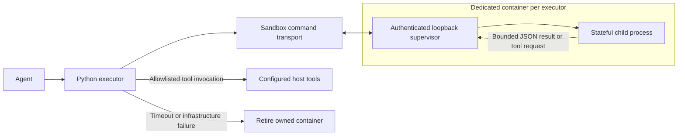

# CodeAct — Python Code as the Agent Action Language

> **Status: experimental — not fully tested.**
> CodeAct is new. The unit tests cover the executor, sandbox tool binding,
> `final_answer` termination, and profile wiring, but end-to-end runs with real
> LLMs have not been systematically validated yet. Expect rough edges and
> behavior changes.

CodeAct is a SmolAgents-inspired agent paradigm: the LLM writes **Python code
blocks** to compose tools, process data, and calculate results. The Python tool
uses a dedicated Docker sandbox by default. Variables persist within that
executor's session, printed output becomes the next observation, and
`final_answer(result)` terminates the calculation.

The separate `LocalPythonExecutor` runs inside the host process and is for
trusted development only. Its AST restrictions are not an isolation boundary.

## Quick start

```bash
uv sync --extra harnessing
uv run cli sandbox start
uv run cli sandbox pull
uv run cli agents run codeact \
  "How many seconds does it takes to a leopart at full speed to run through the Pont des Arts. Use Codeact skill" \
  -m glm5.2@openrouter
```

This runs the `codeact` example profile: the agent looks up the Pont des Arts
length (≈155 m) and the leopard top speed (≈58 km/h) with the sandboxed search
tool, computes the answer in Python, and returns it via `final_answer`.

Useful variants:

```bash
# Interactive chat with the same profile
uv run cli agents run codeact --chat -m glm5.2@openrouter

# Raw NDJSON event stream (useful for debugging the CodeAct loop)
uv run cli agents run codeact "..." -m glm5.2@openrouter --json
```

## Architecture



Components live in [genai_tk/agents/tools/python_executor/](../genai_tk/agents/tools/python_executor/):

| Piece | Role |
|---|---|
| `base.BasePythonExecutor` | Common protocol interface (`aexecute_code`, `reset`, `send_tools`, `send_variables`) |
| `executor.LocalPythonExecutor` | Trusted, in-process AST interpreter with import and operation restrictions; its thread timeout cannot terminate running host code |
| `docker_executor.SandboxedPythonExecutor` | Stateful child process in a dedicated sandbox; bounded JSON tool relay, execution deadline, and explicit cleanup |
| `tool.PythonExecutorTool` | LangChain `BaseTool` wrapper (name `python_interpreter`) that renders `CodeOutput` as text, with a `FINAL ANSWER:` marker on termination |
| `tool.create_python_executor_tools` | Tool factory accepting nested sandbox `tools` (e.g. search tools) exposed directly inside the interpreter |

## The protocol

1. The agent plans one small step and writes a short Python block.
2. The block runs in the sandbox. `print()` output and the last expression
   value come back as the observation; variables persist across blocks.
3. Ordinary code exceptions become observations. Inspect completed tool actions
   before retrying. A timeout or infrastructure failure invalidates the executor;
   it must be replaced, and the original code is never replayed on the host.
4. Calling `final_answer(value)` raises an internal `FinalAnswerException`
   (a `BaseException` subclass, so agent code can't accidentally catch it),
   stops execution, and surfaces the value with a `FINAL ANSWER:` marker.

## Execution and trust boundaries

- **Fail closed:** `executor_type="docker"` is the factory default. The legacy
  `"auto"` and `"sandbox"` names also require isolated execution. Docker startup,
  worker, and transport failures never switch to local execution.
- **Dedicated sessions:** without an explicit `backend`, each executor creates
  and owns a fresh backend. It does not reuse the global `SandboxManager` or a
  harness's context backend. Configured environment variables and volumes are
  omitted from this default backend to avoid inheriting credentials or host
  filesystem access. Worker directories, ports, credentials, and request files
  are session-specific; calls within a session are serialized.
- **Tool relay:** code can request only the host tools registered for that
  executor. Requests and results pass through the sandbox command transport as
  bounded JSON; the executor opens no host HTTP listener. Host tools remain
  privileged capabilities and must validate their own inputs.
  Plain callable tools are registered without being invoked during setup.
  To invoke a factory during setup, use its qualified name, a configuration
  mapping, or an explicit `FactoryToolSpec`.
- **Deadlines and output:** the worker supervisor can terminate its child
  process group at the execution deadline (default 30 seconds). Captured output
  is bounded while it is produced (default 50,000 characters). A timeout or
  transport failure invalidates the executor and retires its owned container.
  A failed retirement is reported as a cleanup failure and requires intervention.
- **State lifecycle:** `reset()` clears variables and agent-defined functions
  while retaining explicitly configured tools. `send_tools()` replaces the
  allowlist, including rejection of retained aliases to revoked tools.
  `send_variables()` and initial state for sandbox execution must be JSON-compatible.
- **Cleanup:** use `await executor.aclose()` in async callers or `executor.close()`
  in synchronous callers. Closed or invalidated executors cannot be revived by
  `reset()`; create a replacement. Closing a default executor retires its own
  container and leaves the shared OpenSandbox service available to peer sessions.
  Use `uv run cli sandbox stop` to stop the service explicitly.

Supplying `backend=` deliberately uses a caller-owned trust boundary, including
any configured mounts and environment. The caller must not share it across
mutually untrusted sessions. Distinct worker tokens and directories do not isolate
malicious code that already shares a container or OS user. After a timeout, the
caller must retire that backend to stop any detached descendants; the executor
only attempts cleanup of its worker on a borrowed backend.
Known host-shell backends are rejected, including a `LocalShellBackend` wrapped
as a composite backend's default. Custom backends must provide genuine isolation.

Container limits and restricted mounts, credentials, network access, and host
tool capabilities are part of the deployment boundary. See
[Sandbox support](sandbox_support.md). A timeout cannot undo a host-tool action,
and an already-running synchronous host tool may continue after its await is
cancelled. Do not automatically retry actions with unknown outcomes.

### Trusted local development

Opt in explicitly with `executor_type="local"`, or construct
`LocalPythonExecutor` directly. This mode executes in the host process. AST import
and attribute restrictions and operation counters help catch mistakes, but do
not make hostile Python safe. A thread timeout cannot kill a native call or host
tool. [CPython's security policy](https://devguide.python.org/security/policy/)
does not support in-process Python sandboxing as a security boundary.

For local mode, declare optional imports such as `pandas` explicitly through
`additional_authorized_imports`; installing a package no longer authorizes it
automatically. Container mode uses the packages installed in its image and does
not apply the local AST import policy.

### Migrating existing callers

| Previous assumption | Required change |
|---|---|
| `auto` runs on the host when Docker is unavailable | Install the `harnessing` extra and start the sandbox service, or explicitly choose trusted `local` mode |
| A Docker error can fall back to local code | Handle the error; `fallback_to_local=True` is rejected |
| Global sandbox reuse separates executor sessions | Let each executor own a backend, or deliberately supply a backend within one trust boundary |
| Default execution inherits configured volumes and environment | Supply an explicit backend only after reviewing the mounts and credentials it grants |
| Any Python object can be injected into a container worker | Send JSON-compatible values or transfer a file into the sandbox |
| Retrying a failed block is harmless | Check completed host-tool actions before retrying; replace an invalidated executor |

## Configuration

Profiles live in [config/examples/agents/codeact.yaml](../config/examples/agents/codeact.yaml):

- **`codeact`** — standalone deep agent. Tools: the Python executor plus
  `create_search_tool` (bound as `web_search(...)` inside the sandbox). Loads
  the CodeAct skill from `skills/runtime/` via `skill_directories`.
- **`codeact-orchestrator`** — deep agent with a single `codeact` **subagent**
  (declared under `subagents:`) that owns the executor; the orchestrator only
  delegates via the `task` tool.

Only `BaseTool` instances survive profile loading; factories returning raw
functions are silently dropped (this is why the profiles use
`create_search_tool`, not `create_search_function`).

### Example profiles

Standalone CodeAct agent (excerpt of the `codeact` profile):

```yaml
agents:
  codeact:
    harness: langchain
    name: "CodeAct"
    type: deep
    description: "Solves tasks by writing Python code blocks in a sandbox; tools are plain functions, print() is the observation, final_answer(x) terminates"
    system_prompt: |
      You are a CodeAct agent. You solve tasks EXCLUSIVELY by writing Python code and
      executing it with the `python_interpreter` tool — never answer by prose alone.

      ## CRITICAL RULES

      1. **Your ONLY action tool is `python_interpreter`**: Never call external tools (like `web_search`)
         directly in the outer agentic loop.
      2. **External tools are registered capabilities**: Sibling tools (e.g. `web_search`)
         are exposed as callable proxies inside Python. Call them in Python:
         `result = web_search("...")`.
      3. **Minimize turns**: Write comprehensive Python scripts that retrieve all needed data,
         parse and process results, perform calculations, and call `final_answer(...)` in a
         single or minimal execution turns. Do NOT take separate turns for individual lookups.
      4. **Deterministic math**: Perform all calculations, unit conversions, and rounding in Python.
      5. **Observability**: Use `print()` to log intermediate data and progress.
      6. **Handle errors deliberately**: Inspect completed tool actions before retrying a code error.
         On timeout or infrastructure failure, stop and report the error; do not replay the block.
      7. **Termination**: Call `final_answer(result)` to return the final answer.

    tools:
      - genai_tk.agents.tools.python_executor.tool.create_python_executor_tools:
          executor_type: docker
          tools:
            - genai_tk.agents.tools.langchain.search_tools_factory.create_search_tool

    skill_directories:          # progressive disclosure of the CodeAct skill
      - ${paths.project}/skills/runtime
      - ${paths.project}/skills/custom

    enable_planning: true
    enable_file_system: false
```

Orchestrator delegating to a codeact-only subagent (excerpt of
`codeact-orchestrator`; the orchestrator itself has no tools — it delegates
via deepagents' `task` tool):

```yaml
agents:
  codeact-orchestrator:
    harness: langchain
    name: "CodeAct Orchestrator"
    type: deep
    description: "Orchestrator that delegates every computation to a dedicated CodeAct subagent"
    system_prompt: |
      You are an orchestrator. You do NOT compute anything yourself.

      For every task that requires computation, data lookup, or multi-step
      reasoning, delegate to the 'codeact' subagent via the task tool and
      relay its final answer. Summarize results clearly for the user.

    tools: []

    subagents:
      - name: codeact
        description: "CodeAct worker: solves tasks by writing Python code in a sandbox."
        system_prompt: |
          You are a CodeAct agent. Solve tasks exclusively by writing Python
          code executed via the python_interpreter tool.

          - web_search(...) is available as a plain function in the sandbox.
          - Variables persist across calls; use print() for observations.
          - Inspect completed tool actions before retrying code errors.
          - Stop on timeout or infrastructure failure; do not replay the block.
          - Terminate by calling final_answer(result).

        tools:
          - genai_tk.agents.tools.python_executor.tool.create_python_executor_tools:
              executor_type: docker
              tools:
                - genai_tk.agents.tools.langchain.search_tools_factory.create_search_tool
```

Subagent dict fields supported by `_resolve_subagents`: `name` and
`description` (required by deepagents), `system_prompt`, `model`, `skills`
(list of paths), and `tools` (list of tool specs, or `null` to inherit the
parent's tools). Subagent toolsets get the same CodeAct sandbox binding as
top-level profiles.

## Extending

- Configure container packages in the image; configure local AST imports with
  `additional_authorized_imports` only for trusted local execution.
- Read the [CodeAct runtime skill](../skills/runtime/codeact/SKILL.md) and
  [Python interpreter development skill](../skills/development/python-interpreter/SKILL.md).
- Regression tests cover fail-closed behavior, tool authorization, worker
  state/reset, output bounds, and process termination:

```bash
uv run pytest tests/unit_tests/tools/test_python_executor.py \
  tests/unit_tests/tools/test_docker_python_executor.py \
  tests/unit_tests/tools/test_sandbox_worker.py -q
uv run cli skills validate --all
```

Real container checks require Docker and `--include-docker`; subprocess tests
alone do not validate a deployed container's mounts, credentials, or network policy.
