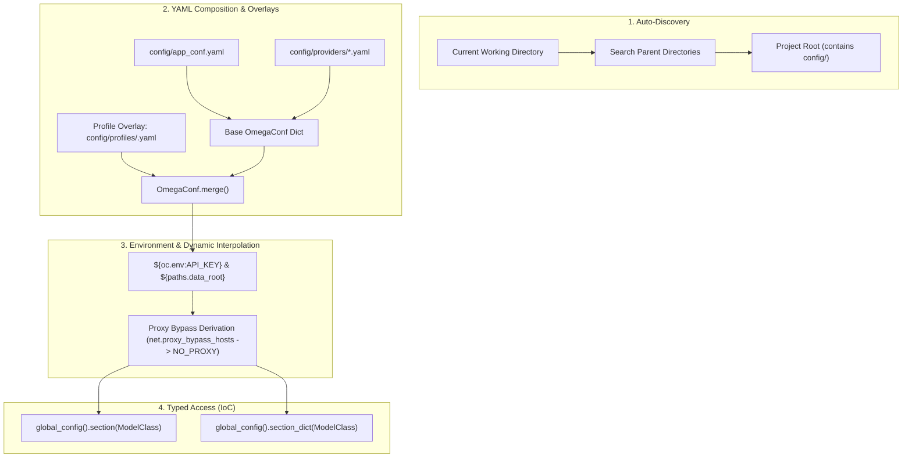

# Design 01: Configuration Management & Profile Overlays

## 1. Architectural Motivation

In modern generative AI applications, configuration is not just a collection of static settings—it is the central control plane. A robust AI toolkit must support:
1. **Dynamic Environment Switching**: Seamless transitions between local development (fast, fake, or local models), testing environments (`pytest` profiles with deterministic fakes), and production deployment (cloud API keys, proxies, rate limits).
2. **Inversion of Control (IoC)**: Declaring components (LLM providers, tool suites, agent profiles, workflows) in configuration rather than hardcoding class instantiations in application code.
3. **Secret & Network Hygiene**: Automatic interpolation of environment variables (`${oc.env:VAR}`), robust proxy bypass derivation (`NO_PROXY` generation), and zero credential leakage.
4. **Strong Typing & Validation**: Strict Pydantic v2 schemas validating configuration trees at runtime while providing auto-completion and typing guarantees across codebases.

---

## 2. Configuration Subsystem Architecture

`genai-tk` uses [OmegaConf](https://omegaconf.readthedocs.io/) wrapped by a custom configuration manager (`genai_tk/config_mgmt/config_mngr.py`) accessible via the global singleton `global_config()`.



### Auto-Discovery Mechanism
The configuration loader auto-discovers the application root by searching upwards from the current working directory until it encounters a `config/` directory or a project marker (`pyproject.toml`, `AGENTS.md`). This enables CLI commands, tests, and scripts to run reliably from any subdirectory.

---

## 3. Profile Overlays & Precedence

The base configuration is loaded from `config/app_conf.yaml`. Specialized profiles can override any section of the tree.

### Profile Hierarchy

```
1. Defaults: Default values in Pydantic models
2. Base Config: config/app_conf.yaml + config/providers/*.yaml + config/agents/*.yaml
3. Profile Overlay: Selected via GENAITK_PROFILE=... or CLI switch --profile ...
4. Environment Variables: ${oc.env:VAR} interpolated dynamically
```

### Example: Base vs. Pytest Profile

In `config/app_conf.yaml`:
```yaml
profile: default

providers:
  llm:
    default: gpt_4o_mini@openai
    fast_model: gpt_4o_mini@openai

net:
  proxy_bypass_hosts:
    - localhost
    - 127.0.0.1
    - internal.corp.net
```

In `config/profiles/pytest.yaml`:
```yaml
# Profile active during automated unit tests
providers:
  llm:
    default: parrot_local@fake
    fast_model: parrot_local@fake
    fake_llm: parrot_local@fake

cache:
  enabled: false
```

When switching profiles programmatically:
```python
from genai_tk.config_mgmt.config_mngr import switch_profile, global_config

switch_profile("pytest")
cfg = global_config()
assert cfg.providers.llm.default == "parrot_local@fake"
```

---

## 4. Environment & Proxy Derivation

To prevent corporate proxies from intercepting internal traffic (e.g., local OpenSandbox containers, Redis, or embedded database sockets), `genai-tk` automatically synchronizes the environment:

1. `net.proxy_bypass_hosts` is parsed from YAML.
2. The hosts are merged with existing `NO_PROXY` / `no_proxy` environment variables.
3. The derived list is exported to `os.environ` before any HTTP or socket connection is initiated.

---

## 5. Typed Access Patterns (Avoiding `Any`)

Never inspect raw configuration dictionaries directly. `genai-tk` mandates typed access via Pydantic v2 schemas:

### Single Section Access: `section()`
```python
from pydantic import BaseModel
from genai_tk.config_mgmt.config_mngr import global_config


class NetConfig(BaseModel):
    proxy_bypass_hosts: list[str] = []
    connect_timeout: float = 30.0


# Automatically resolves top-level 'net' key into NetConfig
net_cfg = global_config().section(NetConfig, key="net")
print(net_cfg.connect_timeout)
```

### Dictionary of Models: `section_dict()`
Useful for registries like agent profiles, MCP servers, or provider definitions:
```python
from pydantic import BaseModel
from genai_tk.config_mgmt.config_mngr import global_config


class ProviderSpec(BaseModel):
    chat_class: str | None = None
    embeddings_class: str | None = None
    decision_class: str | None = None
    api_key_env_var: str | None = None


providers: dict[str, ProviderSpec] = global_config().section_dict(ProviderSpec, key="providers")
openai_spec = providers.get("openai")
```

If the requested key does not exist in the YAML, `section()` returns a default-initialized instance of the Pydantic model, and `section_dict()` returns an empty dictionary. They never raise `KeyError`, guaranteeing safe fallbacks.

---

## 6. References & Cross-Links

- Implementation: `genai_tk/config_mgmt/config_mngr.py`
- Skill Guide: [skills/development/configuration/SKILL.md](../../skills/development/configuration/SKILL.md)
- Next Design Document: [02_ioc_provider_architecture.md](02_ioc_provider_architecture.md) — Inversion of Control & Dynamic Provider Registry
