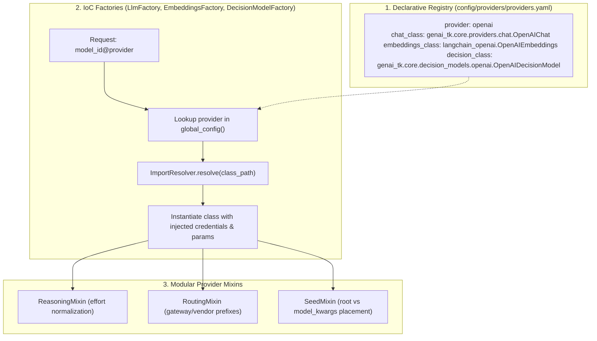

# Design 02: Inversion of Control (IoC) Provider Architecture

## 1. Architectural Problem: The Fragility of Hardcoded Factories

In early iterations of LLM frameworks, model factories rely on monolithic conditional branching:

```python
# ❌ Antipattern: Hardcoded branching in factory
def get_llm(model_id: str, provider: str):
    if provider == "openai":
        return ChatOpenAI(...)
    elif provider == "anthropic":
        return ChatAnthropic(...)
    elif provider == "mistral":
        return ChatMistralAI(...)
    # Adding a new provider requires editing library core source code!
```

This antipattern violates the **Open/Closed Principle** (open for extension, closed for modification):
1. Downstream applications cannot introduce custom, proprietary, or on-prem providers (e.g. vLLM, Ollama, specialized enterprise gateways) without monkey-patching or forking `genai-tk`.
2. Provider-specific idiosyncrasies (such as whether a provider supports `seed`, vendor prefixes like `anthropic/claude-3-7-sonnet`, or reasoning effort parameters) become tangled with factory instantiation logic.
3. Providers that only support one capability (e.g. embedding-only providers or classification-only decision models) pollute chat model logic.

---

## 2. The IoC Solution: Role-Based Class Mappings

`genai-tk` solves this by refactoring provider resolution to **Inversion of Control (IoC)**.



### Role-Based Target Classes
Instead of a single ambiguous entry, `config/providers/providers.yaml` declares explicit roles:

```yaml
providers:
  # Standard cloud provider
  openai:
    chat_class: genai_tk.core.providers.chat.OpenAIChat
    embeddings_class: langchain_openai.OpenAIEmbeddings
    decision_class: genai_tk.core.decision_models.openai.OpenAIDecisionModel
    api_key_env_var: OPENAI_API_KEY
    litellm_prefix: null
    openai_compatible: true

  # Provider with specialized chat but standard embeddings
  mistral:
    chat_class: genai_tk.core.providers.chat.MistralChat
    api_key_env_var: MISTRAL_API_KEY
    litellm_prefix: mistralai
    openai_compatible: false
    seed_param_location: null  # Mistral rejects seed

  # Pure decision model provider (no chat_class)
  laya:
    decision_class: genai_tk.core.decision_models.laya.LayaDecisionModel
    api_key_env_var: LAYA_API_KEY

  # Pure local embeddings provider (no chat_class)
  local:
    embeddings_class: genai_tk.core.providers.embeddings.FastEmbedEmbeddings
```

---

## 3. Modular Behavior Mixins

Different LLM APIs exhibit subtle behavioral divergences. Rather than sprinkling `if provider == ...` across the factory, these differences are encapsulated into composable mixins in `genai_tk/core/providers/mixins.py`:

| Mixin | Responsibility | Supported Behaviors |
|---|---|---|
| `ReasoningMixin` | Normalizes reasoning effort across models | OpenAI `reasoning_effort` (`low`/`medium`/`high`), Anthropic `thinking` budget, Google Gemini `thinking_config` |
| `RoutingMixin` | Handles vendor prefixes and gateways | OpenRouter gateway prefixes, LiteLLM prefixes, EdenAI multi-provider prefixes |
| `SeedMixin` | Controls deterministic sampling seed placement | Direct root parameter (`seed=...`), `model_kwargs={"seed": ...}`, or complete omission |

### Example: Reasoning Effort Normalization
When calling `get_llm("o3-mini@openai", reasoning_effort="high")` or `get_llm("claude-3-7-sonnet@anthropic", reasoning_effort="high")`, the respective provider class invokes `ReasoningMixin.apply_reasoning(kwargs, effort)` to map the conceptual level `"high"` into the exact API parameters required by that specific provider.

---

## 4. Extending the Registry Without Code Changes

Downstream projects or end-users can introduce new providers simply by adding an entry to their own `config/app_conf.yaml` or `config/providers/providers.yaml`.

### Example: Adding a Local vLLM Server
```yaml
# In my_project/config/app_conf.yaml
providers:
  my_vllm:
    chat_class: genai_tk.core.providers.chat.OpenAIChat
    embeddings_class: langchain_openai.OpenAIEmbeddings
    api_base: http://vllm-host:8000/v1
    api_key_env_var: ""  # No auth needed for internal vLLM
    openai_compatible: true
```

The application can immediately invoke:
```python
from genai_tk.core.factories import get_llm

llm = get_llm("meta-llama/Llama-3.3-70B-Instruct@my_vllm")
response = llm.invoke("Explain Inversion of Control in 2 sentences.")
```
No changes to `genai-tk` code are needed. The factory resolves `my_vllm`, discovers `OpenAIChat`, injects the custom base URL, and returns a fully initialized LangChain chat model.

---

## 5. References & Cross-Links

- Implementation: `genai_tk/core/factories/llm_factory.py`, `genai_tk/core/providers/`
- Configuration Reference: `config/providers/providers.yaml`
- Previous Design Document: [01_configuration_and_profiles.md](01_configuration_and_profiles.md) — Configuration Management & Profile Overlays
- Next Design Document: [03_core_llm_and_factories.md](03_core_llm_and_factories.md) — Core LLM, Embeddings & Factory Architecture
