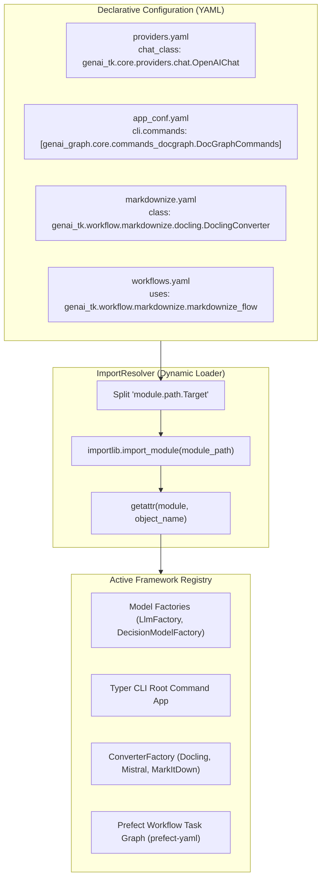

# Design 02: Inversion of Control (IoC) & Dynamic Registry Architecture

## 1. Architectural Philosophy: Universal Inversion of Control

In traditional software frameworks, high-level modules directly instantiate low-level components using concrete imports or rigid conditional branches:

```python
# ❌ Antipattern: Hardcoded conditional branching
def get_component(kind: str):
    if kind == "openai":
        return ChatOpenAI(...)
    elif kind == "docling":
        return DoclingConverter(...)
    elif kind == "custom_cmd":
        return CustomCommands(...)
    # Adding a new capability requires modifying framework source code!
```

This antipattern violates the **Open/Closed Principle** (open for extension, closed for modification) and creates severe fragility in enterprise AI systems:
1. **Downstream Coupling**: Applications cannot plug in proprietary providers, custom CLI commands, localized UI pages, or domain converters without modifying or forking the core library.
2. **Configuration Rigidity**: System components cannot be swapped across environments (e.g. testing with fake models vs. production with enterprise gateways) purely through configuration.
3. **Monolithic Bloat**: Core packages are forced to import and manage dependencies for every optional plugin or provider upfront.

To solve this, **Inversion of Control (IoC)** is a **core architectural design choice** across `genai-tk` and `genai-graph`.
Rather than hardcoding class instantiations, configuration files declare fully qualified Python class names, functions, or package paths (`module.path.ClassName`). At runtime, the framework dynamically resolves, instantiates, and wires these components into the execution lifecycle.

---

## 2. The Dynamic Resolution Engine: `ImportResolver`

The dynamic loading mechanism is powered by `ImportResolver` (`genai_tk/config_mgmt/import_utils.py`).



### Resolution Capabilities
- **Fully Qualified Paths**: Dotted paths such as `genai_tk.core.providers.chat.OpenAIChat` or `genai_graph.orchestration.workflow_steps.kg_create_step` are imported safely via `importlib`.
- **Short-Name Auto-Discovery**: For local project classes, `ImportResolver.import_from_qualified("MyUniqueClass")` scans project ASTs to locate unique class definitions.
- **Fail-Safe Validation**: Provides clear diagnostic error messages if an import fails, pointing to the exact configuration file and missing dependency.

---

## 3. IoC Across the Architectural Pillars

IoC is applied universally across the toolkit. Most configuration files contain Python class names and callables rather than static enums:

### A. LLM, Embeddings & Decision Providers (`config/providers/providers.yaml`)
Instead of monolithic `if/elif` branches in `LlmFactory`, providers specify role-targeted implementation classes:

```yaml
providers:
  # Standard cloud provider
  openai:
    chat_class: genai_tk.core.providers.chat.OpenAIChat
    embeddings_class: langchain_openai.OpenAIEmbeddings
    decision_class: genai_tk.core.decision_models.openai.OpenAIDecisionModel
    api_key_env_var: OPENAI_API_KEY
    litellm_prefix: null
    openai_compatible: true

  # Provider with specialized chat but standard embeddings
  mistral:
    chat_class: genai_tk.core.providers.chat.MistralChat
    api_key_env_var: MISTRAL_API_KEY
    litellm_prefix: mistralai
    openai_compatible: false
    seed_param_location: null

  # Pure decision model provider (no chat_class)
  laya:
    decision_class: genai_tk.core.decision_models.laya.LayaDecisionModel
    api_key_env_var: LAYA_API_KEY

  # Pure local embeddings provider (no chat_class)
  local:
    embeddings_class: genai_tk.core.providers.embeddings.FastEmbedEmbeddings
```

Provider behaviors are composed using modular mixins (`ReasoningMixin`, `RoutingMixin`, `SeedMixin`), normalizing reasoning effort and gateway prefixes without factory changes.

### B. Command-Line Interface (CLI) Commands (`config/app_conf.yaml`)
The unified CLI (`cli`) does not hardcode which commands exist. Downstream packages register CLI command groups by listing their fully qualified class or function paths:

```yaml
# config/app_conf.yaml
cli:
  commands:
    # Core toolkit commands
    - genai_tk.cli.commands_core.CoreCommands
    - genai_tk.cli.commands_info.InfoCommands
    - genai_tk.cli.commands_skills.SkillsCommands
    - genai_tk.workflow.commands.WorkflowCommands
    - genai_tk.agents.commands_agents.AgentCommands
    # Downstream extension commands (genai-graph)
    - genai_graph.core.commands_docgraph.DocGraphCommands
    - genai_graph.core.commands_bench.BenchCommands
    # Custom application command group
    - my_package.commands.CustomDomainCommands
```

Each class subclasses `genai_tk.cli.base.CliTopCommand` (or exposes a `register_commands(app: typer.Typer)` function). The CLI orchestrator dynamically imports and mounts them onto the root command group during startup.

### C. Web Application & UI Navigation (`config/webapp.yaml` / `config/app_conf.yaml`)
The multi-page Streamlit web application (`just webapp`) constructs its navigation menu dynamically from configuration:

```yaml
# config/app_conf.yaml (or config/webapp.yaml)
ui:
  app_name: "Enterprise Knowledge Portal"
  pages_dir: ${paths.src}/webapp/pages
  navigation:
    agents:
      # Cross-package reference: embeds built-in page from installed genai-tk
      - genai_tk://demos/agent.py
    knowledge_graph:
      # Downstream custom page (relative to ui.pages_dir)
      - explorer/kg_browser.py
      - analytics/metrics_dashboard.py
```

The webapp resolves `genai_tk://` paths dynamically to the installed library resources via `importlib.resources`, allowing downstream applications to reuse production UI workbenches without copying files.

### D. Workflow Orchestration Steps (`config/workflows/*.yaml`)
Workflows compiled by `prefect-yaml` declare step tasks as Python callable paths:

```yaml
workflows:
  full_ingestion_pipeline:
    description: "Multi-stage document conversion and knowledge graph construction"
    steps:
      - id: office_to_pdf
        uses: genai_tk.extra.office2pdf_prefect_flow.office2pdf_flow
        inputs:
          root_dir: "${profile.raw_dir}"
          output_dir: "${profile.pdf_dir}"

      - id: convert_to_markdown
        uses: genai_tk.workflow.markdownize.markdownize_flow
        needs: [office_to_pdf]
        inputs:
          root_dir: "${profile.pdf_dir}"
          output_dir: "${profile.md_dir}"

      - id: build_graph
        uses: genai_graph.orchestration.workflow_steps.kg_create_step
        needs: [convert_to_markdown]
        inputs:
          config_name: "${profile.kg_config}"
```

Independent step implementations remain decoupled from the workflow engine and can be executed as standalone Python functions, Prefect flows, or workflow steps.

### E. Document Converters (`config/markdownize.yaml`)
Document conversion engines are registered in `config/markdownize.yaml`:

```yaml
markdownize_converters:
  docling:
    class: genai_tk.workflow.markdownize.docling.DoclingConverter
    params:
      extract_tables: true
  mistral_ocr:
    class: genai_tk.workflow.markdownize.mistral.MistralOcrConverter
  markitdown:
    class: genai_tk.workflow.markdownize.markitdown.MarkitdownConverter
  custom_ocr:
    class: my_package.converters.ProprietaryOCRConverter
```

`ConverterFactory.create(name)` resolves `class:`, instantiates the converter, and passes keyword parameters directly.

### F. Agent Tools, Middlewares & Sandboxes (`config/agents/*.yaml`)
Agent configurations reference factory functions and class paths directly:
- **Tools**: `tools: [genai_tk.agents.tools.web_search.create_web_search_tools, my_package.tools.create_db_tools]`
- **Middleware**: `middlewares: [genai_tk.agents.langchain.middleware.SensitivityRouterMiddleware]`
- **Checkpointers**: `checkpointer: langgraph.checkpoint.memory.MemorySaver`
- **Sandbox Backends**: `backend_class: genai_tk.agents.sandbox.docker.DockerSandboxBackend`

---

## 4. Extending the Framework in Downstream Applications

Because of this universal IoC architecture, downstream applications (such as `genai-graph`, `wiki`, `officeqa`, or `rfq_pricing`) never need to fork `genai-tk`.

### Example: Adding a Local vLLM Server & Custom Commands
A downstream application configures its own `config/app_conf.yaml`:

```yaml
# In my_app/config/app_conf.yaml
providers:
  onprem_vllm:
    chat_class: genai_tk.core.providers.chat.OpenAIChat
    embeddings_class: langchain_openai.OpenAIEmbeddings
    api_base: http://vllm-cluster:8000/v1
    api_key_env_var: ""  # Internal network, no key needed
    openai_compatible: true

cli:
  commands:
    - my_app.commands.analytics.AnalyticsCommands
```

The application immediately gains:
1. `get_llm("meta-llama/Llama-3.3-70B-Instruct@onprem_vllm")` without writing any provider adapter.
2. `cli analytics ...` automatically mounted into the root CLI.
3. Full compatibility with agent profiles, caching, and evaluation pipelines.

---

## 5. Architectural Benefits

| Benefit | Impact |
|---|---|
| **Zero Core Modifications** | New capabilities, backends, commands, and tools are added purely through YAML configuration and standard Python classes. |
| **Effortless Test Mocking** | Test profiles (`pytest.yaml`) swap production classes for fakes (`parrot_local@fake`, `MemoryStore`) without changing application logic. |
| **Monorepo Ecosystem Synergy** | Sibling repositories (`genai-graph`, `rfq_pricing`, `wiki`) share core primitives while maintaining strict domain encapsulation. |
| **Strict Type Safety** | Factory boundary methods enforce typed Pydantic v2 validation over dynamic instances, eliminating runtime surprises. |

---

## 6. References & Cross-Links

- Dynamic Resolution: `genai_tk/config_mgmt/import_utils.py`
- Model Factories: `genai_tk/core/factories/llm_factory.py`, `genai_tk/core/factories/decision_model_factory.py`
- CLI Engine: `genai_tk/main/cli.py`, `genai_tk/cli/base.py`
- Webapp Loader: `genai_tk/webapp/`
- Previous Design Document: [01_configuration_and_profiles.md](01_configuration_and_profiles.md) — Configuration Management & Profile Overlays
- Next Design Document: [03_core_llm_and_factories.md](03_core_llm_and_factories.md) — Core LLM, Embeddings & Factory Architecture
