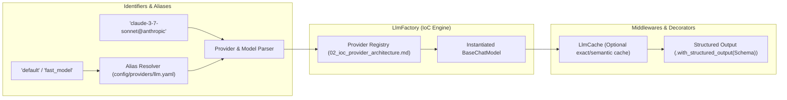

# Design 03: Core LLM, Embeddings & Factory Architecture

## 1. Overview & Architectural Role

The `core` subsystem (`genai_tk/core/`) provides the fundamental building blocks for all model-driven operations in `genai-tk`:
- **Model Instantiation**: Standardized creation of chat models and embeddings across heterogeneous providers via `get_llm()` and `get_embeddings()`.
- **Identity & Aliasing**: Uniform identification format (`model_id@provider`) combined with friendly YAML aliases (`default`, `fast_model`).
- **Semantic & Exact Caching**: `LlmCache` supporting local SQLite, Redis, or in-memory response caches to minimize cost and latency during development and testing.
- **Runnable Registry**: `ChainRegistry` for organizing, discovering, and executing LangChain Expression Language (LCEL) chains.
- **Vector Backends**: `EmbeddingsStore` unifying Zvec, PGVector, and in-memory vector collections. Zvec operations hold a file lock only while the native collection is open, flush writes, and close handles before returning. Legacy Chroma configurations fail before model resolution or storage access; migrations create fresh indexes from trusted source documents.



---

## 2. Model Identifier Specification

Model identifiers follow the canonical pattern:
```
<model_identifier>@<provider_key>
```
Examples:
- `gpt-4o-mini@openai`
- `claude-3-7-sonnet@anthropic`
- `mistral-large-latest@mistral`
- `qwen/qwen-2.5-72b-instruct@openrouter`
- `parrot_local@fake`

### YAML Aliases
In `config/providers/llm.yaml`:
```yaml
aliases:
  default: gpt-4o-mini@openai
  fast_model: gpt-4o-mini@openai
  reasoning_model: o3-mini@openai
  fake: parrot_local@fake
```
Calling `get_llm("fast_model")` automatically resolves to the configured target model.

---

## 3. Core Factory APIs

### Creating LLM Instances
```python
from genai_tk.core.factories import get_llm

# Using alias
llm = get_llm("fast_model")

# Explicit model and provider
llm = get_llm("claude-3-7-sonnet@anthropic", temperature=0.2)

# With normalized reasoning effort
deep_llm = get_llm("o3-mini@openai", reasoning_effort="high")
```

### Structured Output with Pydantic v2
Never parse model output with regular expressions. Always use Pydantic models with `with_structured_output`:
```python
from pydantic import BaseModel, Field
from genai_tk.core.factories import get_llm


class EntityExtraction(BaseModel):
    entities: list[str] = Field(description="Extracted named entities")
    confidence: float = Field(ge=0.0, le=1.0)


llm = get_llm("fast_model")
structured_llm = llm.with_structured_output(EntityExtraction)

result: EntityExtraction = structured_llm.invoke("Alice works at Atos in Paris.")
print(result.entities)  # ['Alice', 'Atos', 'Paris']
```

### Embeddings Factory
```python
from genai_tk.core.factories import get_embeddings

# Resolves to OpenAI, Cohere, FastEmbed, or fake based on config
embedder = get_embeddings("text-embedding-3-small@openai")
vectors = embedder.embed_documents(["First document", "Second document"])
```

---

## 4. Semantic & Exact Caching (`LlmCache`)

To reduce API expenditures and accelerate test execution, `genai-tk` provides `LlmCache` (`genai_tk/core/cache.py`):
- **Exact Match Cache**: Keyed on SHA-256 hash of model name, temperature, and serialized message prompt.
- **Cache Invalidation**: Automatic cache invalidation based on TTL or explicit profile flags (`cache.enabled: false` in `pytest.yaml`).

---

## 5. Chain Registry (`ChainRegistry`)

LangChain Expression Language (LCEL) chains can be registered centrally, decoupled from caller execution sites:
```python
from genai_tk.core.chains import register_chain, get_chain
from langchain_core.prompts import ChatPromptTemplate
from langchain_core.output_parsers import StrOutputParser

prompt = ChatPromptTemplate.from_template("Summarize in 10 words: {text}")
chain = prompt | get_llm("fast_model") | StrOutputParser()

register_chain("quick_summary", chain)

# In another module or CLI command:
summary_chain = get_chain("quick_summary")
print(summary_chain.invoke({"text": "Long article content..."}))
```

---

## 6. Testing Philosophy: Fake Providers

**Never make live API calls in unit tests.**
The toolkit provides `parrot_local@fake` and `embeddings_768@fake`, pre-configured in the `pytest` profile. These models execute entirely in-process without network latency, API costs, or risk of rate-limiting failures.

---

## 7. References & Cross-Links

- Implementation: `genai_tk/core/factories/llm_factory.py`, `genai_tk/core/factories/embeddings_factory.py`
- Previous Design Document: [02_ioc_provider_architecture.md](02_ioc_provider_architecture.md) — Inversion of Control (IoC) Provider Architecture
- Next Design Document: [04_decision_models_system1.md](04_decision_models_system1.md) — Fast System 1 Decision Models
