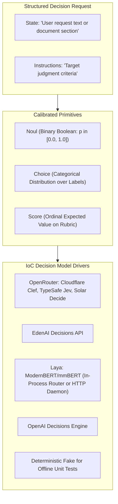

# Design 04: Fast System 1 Decision Models

## 1. Motivation: System 1 vs. System 2 Reasoning

Standard Large Language Models are **System 2** reasoning engines: they generate output tokens autoregressively. While powerful for complex generation, using full LLMs for high-volume binary classification, semantic routing, or safety filtering is:
1. **Slow**: Token generation incurs 500ms–2000ms latency.
2. **Expensive**: Generating tokens incurs output pricing, even when answering simple yes/no questions.
3. **Uncalibrated**: Autoregressive logit probabilities are poorly calibrated and susceptible to prompt variance.

To solve this, `genai-tk` introduces **System 1 Decision Models** (`genai_tk/core/decision_models/`). These models evaluate structured state against narrow, typed questions, returning calibrated probabilities directly in sub-100ms latency.



---

## 2. Mathematical Primitives

All decision judgments in `genai-tk` evaluate to one of three strictly typed primitives:

### 1. `Noul` (Binary Boolean Probability)
A calibrated scalar probability $p \in [0.0, 1.0]$ representing the degree of belief in an affirmative (Yes / True) answer.
- Returns: `noul: float`, `confidence: float`, `decision: bool` (thresholded at $p \ge 0.5$).

### 2. `Choice` (Categorical Classification)
A probability distribution over mutually exclusive category keys.
- Returns: `choice: str` (argmax label), `confidence: float`, `probabilities: dict[str, float]`.
- $\sum_{i} P(\text{choice}_i) = 1.0$.

### 3. `Score` (Ordinal Rubric Evaluation)
An expected value computed over an ordered numeric or rubric scale.
- Returns: `score: float` (expected value $\mathbb{E}[S] = \sum s_i P(s_i)$), `confidence: float`, `probabilities: dict[str, float]`.

---

## 3. Strict Type Hierarchy (Elimination of `Any`)

In compliance with `genai-tk` typing invariants, the decision model framework defines explicit Pydantic v2 hierarchies:

```python
from pydantic import BaseModel, Field


class BaseQuestion(BaseModel):
    """Abstract base for decision questions."""

    id: str
    instructions: str
    model_config = {"frozen": True}


class NoulQuestion(BaseQuestion):
    """Binary boolean inquiry."""

    pass


class ChoiceQuestion(BaseQuestion):
    """Categorical inquiry with explicit criteria."""

    criteria: dict[str, str] = Field(..., description="Mapping of label to description")


class ScoreQuestion(BaseQuestion):
    """Ordinal rubric inquiry."""

    rubric: list[str] = Field(..., description="Ordered list of rubric grades")


class BaseAnswer(BaseModel):
    """Calibrated result from a decision inquiry."""

    question_id: str
    confidence: float = Field(ge=0.0, le=1.0)
    model_config = {"frozen": True}
```

No untyped dicts or `Any` parameters are permitted at API boundaries.

---

## 4. Supported Providers & Drivers

| Provider | Driver Class | Capabilities & Latency |
|---|---|---|
| **Laya** | `LayaDecisionModel` | Non-autoregressive ModernBERT/mmBERT. **Sub-35ms GPU / 100ms CPU**. Modes: `router` (in-process) or `server` (HTTP daemon). Supports 100+ languages. |
| **OpenRouter** | `OpenRouterDecisionModel` | Clef Flash 9B (`clef_flash`), Clef 27B, TypeSafe Jev (`jev`), Upstage Solar Decide (`solar_decide_flash`). |
| **EdenAI** | `EdenAIDecisionModel` | Decisions API via `https://api.edenai.run/v3/alpha/decisions`. |
| **OpenAI** | `OpenAIDecisionModel` | Native decision endpoints via `langchain-openai`. |
| **Fake** | `FakeDecisionModel` | Offline deterministic decision stub for unit tests. |

---

## 5. Batch Invocation & Auto-Chunking

Decision backends often enforce hardware or protocol limits on the maximum number of questions evaluated simultaneously (e.g. Clef Flash allows up to 64 questions; Jev allows 32).

`BaseDecisionModel.batch_invoke()` automatically enforces:
1. **`max_questions` Validation**: Validates the model's configured question ceiling.
2. **Auto-Chunking**: Splits large candidate lists into compliant batches, dispatches them concurrently, and reconstitutes the results in original order.

### Python Usage Example
```python
from genai_tk.core.factories import get_decision_model

decision_model = get_decision_model("clef_flash@openrouter")

# Quick binary evaluation
p_urgent = decision_model.decide_noul(
    state="Customer database latency spiked to 4500ms and connections timed out.",
    instructions="Does this indicate an active critical production incident?",
)
print(f"Urgent: {p_urgent.decision} (p={p_urgent.noul:.2f})")

# Categorical routing
route = decision_model.decide_choice(
    state="Where can I download my annual tax withholding statement?",
    instructions="Route this user request to the appropriate department.",
    criteria={
        "hr": "Employee records, tax forms, compensation, benefits",
        "it": "Hardware, software, passwords, network access",
        "billing": "Customer invoices, payments, subscriptions",
    },
)
print(f"Destination: {route.choice} (confidence={route.confidence:.2f})")
```

---

## 6. CLI Usage

The decision subsystem is exposed via `cli core decision`:

```bash
# Evaluate binary condition
uv run cli core decision noul \
  --state "Error 500 on checkout" \
  --instructions "Is this an outage?" \
  --model clef_flash@openrouter

# Categorical routing
uv run cli core decision choice \
  --state "Reset my VPN access" \
  --instructions "Route department" \
  --criteria '{"it": "VPN/Accounts", "hr": "Payroll"}'
```

---

## 7. References & Cross-Links

- Implementation: `genai_tk/core/decision_models/`
- Skill Guide: [skills/development/decision-models/SKILL.md](../../skills/development/decision-models/SKILL.md)
- Configuration: `config/providers/decision_models.yaml`
- Previous Design Document: [03_core_llm_and_factories.md](03_core_llm_and_factories.md) — Core LLM, Embeddings & Factory Architecture
- Next Design Document: [05_agent_harness_and_middleware.md](05_agent_harness_and_middleware.md) — Autonomous Agent Harness & Cross-Harness Middleware
