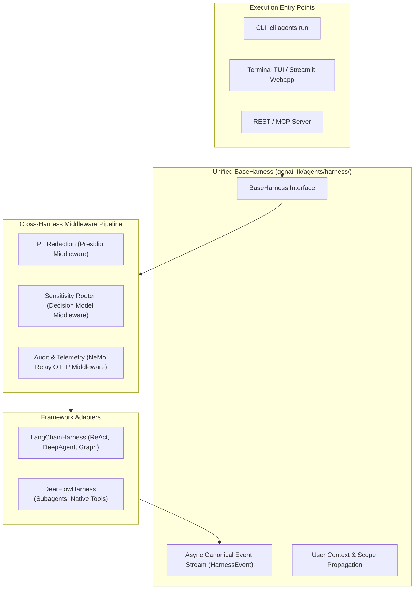

# Design 05: Autonomous Agent Harness & Cross-Harness Middleware

## 1. Architectural Challenge: Runtime Fragmentation

Modern agentic engineering presents a challenge: different agent architectures excel at different tasks:
- **LangChain / LangGraph**: Industry-standard tool use, deep planning graphs, checkpointers, and wide tool ecosystems.
- **DeerFlow**: Fast, multi-step subagent execution with native bash and Python tools and pro-mode planning.

Historically, each framework required its own CLI runner, its own event format, and its own middleware mechanisms. An enterprise feature (such as Presidio PII redaction or sensitive query routing) had to be implemented twice or three times.

---

## 2. The Unified Harness Solution

`genai-tk` introduces the **Unified Harness Layer** (`genai_tk/agents/harness/`), defining an engine-agnostic abstraction for agent execution.



---

## 3. Canonical Event Streaming

Regardless of whether the underlying agent is LangChain or DeerFlow, the harness emits a normalized async generator of `HarnessEvent` records:

| Event Type | Payload | Meaning |
|---|---|---|
| `step_start` | `step_index`, `agent_name` | Agent initiated a new cognitive cycle |
| `thought` | `content: str` | Model internal reasoning / scratchpad text |
| `tool_call` | `tool: str`, `args: dict` | Invocation of an external tool or code executor |
| `tool_result`| `tool: str`, `output: str` | Captured output from tool execution |
| `final_answer`| `content: str` | Complete synthesized response to user |
| `error` | `message: str`, `trace: str` | Unhandled exception or safety interruption |

This allows all frontend consumers (CLI chat, Streamlit webapps, trajectory loggers) to be implemented once against the canonical event stream.

---

## 4. Cross-Harness Middleware Pipeline

Middlewares wrap agent invocations at the boundary. They run before input reaches the agent runtime and after output leaves:

```python
class BaseHarnessMiddleware:
    async def before_run(self, context: HarnessRunContext) -> HarnessRunContext:
        """Inspect, modify, or redact user input before agent receives it."""
        return context

    async def after_run(self, context: HarnessRunContext, result: HarnessResult) -> HarnessResult:
        """Inspect or redact agent response before returning to caller."""
        return result
```

### 1. PII Anonymization Middleware
Leverages Microsoft Presidio and spaCy NLP to detect French and English names, social security numbers, IBANs, and API keys. Sensitive entities are replaced with deterministic pseudonyms (`<PERSON_1>`, `<IBAN_1>`) before the prompt reaches any external LLM provider.

### 2. Sensitive Model Routing Middleware
Employs a System 1 Decision Model (`04_decision_models_system1.md`) to categorize user queries. Unrestricted public queries are routed to high-speed cloud models; queries containing internal company identifiers or financial data are dynamically diverted to on-prem air-gapped instances.

### 3. User Context & Scope Propagation
Propagates identity claims (`user_id`, `roles`, `organization_id`) down through the agent execution tree into data retrieval tools, enforcing access control and security trimming.

---

## 5. Agent Profile Configuration

Agent profiles are declared declaratively in YAML, keyed by a distinct profile key:

```yaml
# config/agents/langchain/researcher.yaml
profile_key: researcher
display_name: "Autonomous Research Agent"
type: deep  # react | deep | custom
llm: gpt_4o_mini@openai

system_prompt: |
  You are an expert technical researcher. Explore topics thoroughly,
  verify claims with tools, and cite specific sources.

tools:
  - genai_tk.agents.tools.web_search.create_web_search_tools
  - genai_tk.agents.tools.document.create_doc_tools

skills:
  - query-writing
  - schema-exploration

backend:
  type: aio_sandbox  # none | aio_sandbox | class
```

Executing the agent:
```bash
uv run cli agents run researcher "Analyze the Q3 semiconductor supply chain bottlenecks"
```

---

## 6. References & Cross-Links

- Implementation: `genai_tk/agents/harness/`, `genai_tk/agents/langchain/`, `genai_tk/agents/deer_flow/`
- User Guide: [docs/harness.md](../harness.md), [docs/agents.md](../agents.md)
- Previous Design Document: [04_decision_models_system1.md](04_decision_models_system1.md) — Fast System 1 Decision Models
- Next Design Document: [06_sandbox_and_codeact.md](06_sandbox_and_codeact.md) — Sandbox Isolation & Python CodeAct
