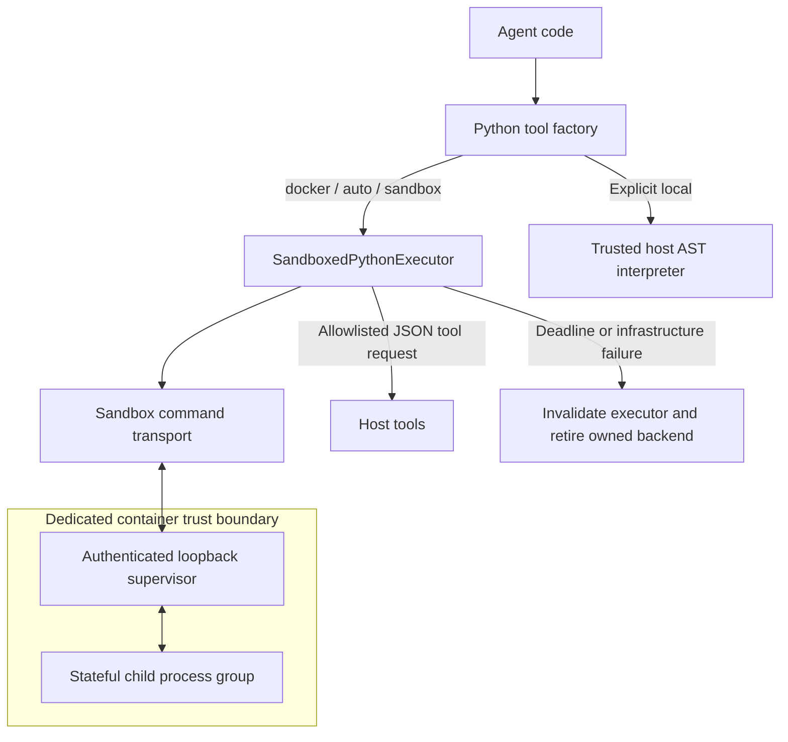

# Design 06: Sandbox Isolation & Python CodeAct

## 1. Motivation: Isolated Execution & Reproducible Calculations

Autonomous agents frequently need to execute code:
1. **Reproducible Calculations**: Python makes arithmetic and transformations inspectable and repeatable. Inputs, formulas, numerical precision, and interpretation still require validation.
2. **File & Data Manipulation**: Parsing CSV/Excel tables, generating graphs, and converting documents.
3. **Security Invariant**: Executing arbitrary LLM-generated code directly on the developer's workstation or production host introduces severe security risks (filesystem corruption, credential leakage, host compromise).

`genai-tk` separates the execution interface from its isolation boundary:
- **`SandboxBackendProtocol`** describes filesystem and command operations; implementing the protocol does not itself provide isolation.
- **`AioSandboxBackend`** manages an OpenSandbox container with configured resources and mounts.
- **`SandboxedPythonExecutor`** owns a dedicated backend by default and supervises a stateful child process inside it.
- **`LocalPythonExecutor`** is explicitly trusted host execution. AST restrictions do not turn it into an OS sandbox.



---

## 2. Backend and Worker Contracts

[AioSandboxBackend](../../genai_tk/agents/sandbox/aio_backend.py) implements the
DeepAgents `SandboxBackendProtocol`. Its `aexecute()` returns an
`ExecuteResponse`; filesystem methods return the protocol's structured results.
The Python executor uses that existing transport to start and communicate with
its worker, including tool-call/result relay. It does not expose a host HTTP
server or deserialize worker-controlled pickle data.

The worker supervisor authenticates requests before parsing JSON and enforces
request-size limits. A separate child process keeps Python state between calls.
The supervisor exchanges bounded JSON messages with the child, enforces the wall
deadline, and terminates its process group on expiry. Captured logs are bounded
while produced. Runtime and process resource limits complement these controls.

Each executor has unique worker paths, credentials, and serialized requests.
`reset()` recreates the child namespace; configured tools are retained, while
variables and agent-defined functions are discarded. Replacing the toolset
revokes old names even if code retained a proxy alias.

The default executor creates its own backend rather than acquiring a shared
`SandboxManager` backend. It omits configured environment variables and host
volumes. Explicit `backend=` is a caller-owned mode that can grant those
capabilities within one trust boundary. Co-resident malicious code can access a
shared container's files and processes; per-worker authentication is not tenant
isolation.

A fatal worker/transport failure or deadline invalidates the executor. Its owned
backend is retired so detached descendants cannot continue there; cleanup
failures are surfaced for intervention. For a borrowed backend, the caller must
retire the entire runtime after a timeout. Neither `reset()` nor a later request
revives an invalidated executor. `aclose()` provides explicit async cleanup;
`close()` is the synchronous wrapper.

Generic AIO command deadlines also retire their backend on timeout or
cancellation. A failed control-plane kill remains an error, with the backend
reference retained for cleanup retry.

The default factory mode is `docker`; `auto` and `sandbox` are compatibility
aliases that also require isolation. Only explicit `local` selects host
execution. `fallback_to_local=True` is rejected.

---

## 3. Production Hardening & Lessons Learned

### 1. Core Dump Prevention (`ulimit core=0`)
Running heavy Python compilation or C-extensions inside containerized agents under high concurrency previously generated massive core dump files on unexpected crashes, exhausting disk space.
The generated local OpenSandbox server configuration sets a zero core-dump
limit. Externally managed servers need the same runtime policy.

### 2. Resource and Capability Limits

AIO settings default to one CPU and 2048 MiB of container memory. The generated
local server additionally sets a 256-process limit and `no_new_privileges`.
The Python child has a supplementary Linux address-space cap (1024 MiB by
default). These limits must be validated against the deployed runtime and
workload; the client cannot guarantee an external server's policy.

Expose only task-required mounts, network access, and host tools. Network egress
restriction is a deployment responsibility, not a guarantee of this worker.
Tool dispatch checks the current session allowlist. A tool may use privileged
credentials on the host, and its side effects may outlive an await timeout. Do
not retry an uncertain tool call automatically or claim that container cleanup
rolls it back.

### 3. Concurrency Isolation for Headless LibreOffice
When converting multiple Office documents concurrently, LibreOffice headless processes share a default user profile lock file, causing random, silent `exit 1` failures.
`genai-tk` isolates every parallel conversion by injecting a dedicated temporary profile:
```bash
libreoffice --headless -env:UserInstallation=file://<temp_unique_dir> --convert-to pdf ...
```
This prevents different conversions from contending over the same LibreOffice
profile lock; other application and filesystem errors remain possible.

### 4. Container Pre-Warming Daemon
Container startup latency depends on the image, runtime, and host.
`genai-tk` provides pre-warming management commands:
```bash
uv run cli sandbox start   # Starts background OpenSandbox service
uv run cli sandbox pull    # Pre-pulls the configured image
uv run cli sandbox status  # Verifies health and ready state
uv run cli sandbox stop    # Cleans up containers
```
Preparing the service and image avoids repeated downloads. A dedicated Python
executor still creates its own container; pre-warming does not authorize sharing
one container between mutually untrusted sessions.

---

## 4. Python CodeAct for Calculations

In standard ReAct, an agent attempts to reason in natural language. In **CodeAct**, the agent writes executable Python code to compute answers:

```python
from genai_tk.agents.tools.python_executor import SandboxedPythonExecutor

executor = SandboxedPythonExecutor()
try:
    result = await executor.aexecute_code("""
import pandas as pd
df = pd.read_csv("financials.csv")
ebitda_margin = (df['ebitda'].sum() / df['revenue'].sum()) * 100
print(f"{ebitda_margin:.2f}%")
""")
finally:
    await executor.aclose()
```

This async example assumes the input file is already available inside the
sandbox. Validate the source data, formula, and denominator before relying on the
result. A successful computation does not establish business correctness.

## 5. Regression Coverage

Regression tests exercise fail-closed executor errors, bounded authenticated
worker requests, tool authorization, independent state, complete reset, output
bounds, and child termination at the deadline. Real Docker tests additionally
exercise the deployed transport. See
[test_docker_python_executor.py](../../tests/unit_tests/tools/test_docker_python_executor.py)
and [test_sandbox_worker.py](../../tests/unit_tests/tools/test_sandbox_worker.py).

No test suite establishes safety for arbitrary host mounts or privileged tools;
those remain deployment-specific trust decisions.

---

## 6. References & Cross-Links

- Implementation: [sandbox backends](../../genai_tk/agents/sandbox/) and [Python executors](../../genai_tk/agents/tools/python_executor/)
- User Guide: [docs/sandbox_support.md](../sandbox_support.md), [docs/codeact.md](../codeact.md)
- Previous Design Document: [05_agent_harness_and_middleware.md](05_agent_harness_and_middleware.md) — Autonomous Agent Harness & Cross-Harness Middleware
- Next Design Document: [07_workflow_engine_and_prefect.md](07_workflow_engine_and_prefect.md) — Workflow Engine & Prefect-YAML Integration
