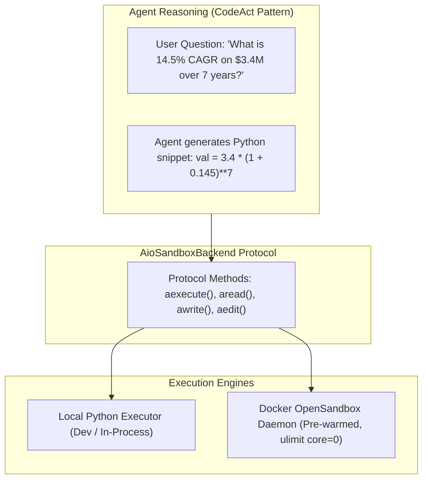

# Design 06: Sandbox Isolation & Python CodeAct

## 1. Motivation: Safe Execution & Mathematical Precision

Autonomous agents frequently need to execute code:
1. **Mathematical Accuracy**: LLMs struggle with multi-step arithmetic, floating-point calculations, and statistical aggregation. Generating Python code to calculate results yields 100% mathematical precision.
2. **File & Data Manipulation**: Parsing CSV/Excel tables, generating graphs, and converting documents.
3. **Security Invariant**: Executing arbitrary LLM-generated code directly on the developer's workstation or production host introduces severe security risks (filesystem corruption, credential leakage, host compromise).

`genai-tk` provides a hardened dual-layer execution architecture:
- **`AioSandboxBackend` Protocol**: Standardized asynchronous filesystem and process execution contract.
- **Docker OpenSandbox**: Isolated container sandbox with pre-warming, core dump suppression (`ulimit core=0`), and isolated temporary user profiles.



---

## 2. The `AioSandboxBackend` Protocol

The execution backend implements the asynchronous protocol (`genai_tk/agents/sandbox/backend.py`):

```python
class AioSandboxBackend(Protocol):
    async def aexecute(self, command: str, timeout: int = 60) -> tuple[int, str, str]:
        """Execute a shell command inside the sandbox; returns (exit_code, stdout, stderr)."""
        ...

    async def aread(self, path: str) -> str:
        """Read file contents safely from the sandbox."""
        ...

    async def awrite(self, path: str, content: str) -> None:
        """Write content to a file inside the sandbox."""
        ...

    async def aupload_files(self, host_files: list[tuple[Path, str]]) -> None:
        """Copy local files into sandbox destination."""
        ...
```

---

## 3. Production Hardening & Lessons Learned

### 1. Core Dump Prevention (`ulimit core=0`)
Running heavy Python compilation or C-extensions inside containerized agents under high concurrency previously generated massive core dump files on unexpected crashes, exhausting disk space.
`genai-tk` launches all sandbox containers with `--ulimit core=0`, strictly preventing core file creation.

### 2. Concurrency Isolation for Headless LibreOffice
When converting multiple Office documents concurrently, LibreOffice headless processes share a default user profile lock file, causing random, silent `exit 1` failures.
`genai-tk` isolates every parallel conversion by injecting a dedicated temporary profile:
```bash
libreoffice --headless -env:UserInstallation=file://<temp_unique_dir> --convert-to pdf ...
```
This guarantees race-condition-free parallel document conversion.

### 3. Container Pre-Warming Daemon
Starting a fresh Docker container on-demand per user request introduces 20–30s latency.
`genai-tk` provides pre-warming management commands:
```bash
uv run cli sandbox start   # Starts and pre-warms background container
uv run cli sandbox status  # Verifies health and ready state
uv run cli sandbox stop    # Cleans up containers
```
With pre-warming active, agent code execution latency drops from ~28s to ~50ms.

---

## 4. Python CodeAct for Mathematical Accuracy

In standard ReAct, an agent attempts to reason in natural language. In **CodeAct**, the agent writes executable Python code to compute answers:

```python
# CodeAct tool invocation
result = sandbox.execute_python("""
import pandas as pd
df = pd.read_csv("financials.csv")
ebitda_margin = (df['ebitda'].sum() / df['revenue'].sum()) * 100
print(f"{ebitda_margin:.2f}%")
""")
# Output: "24.85%"
```

This ensures zero arithmetic hallucinations in financial, engineering, and scientific tasks.

---

## 5. References & Cross-Links

- Implementation: `genai_tk/agents/sandbox/`
- User Guide: [docs/sandbox_support.md](../sandbox_support.md), [docs/codeact.md](../codeact.md)
- Previous Design Document: [05_agent_harness_and_middleware.md](05_agent_harness_and_middleware.md) — Autonomous Agent Harness & Cross-Harness Middleware
- Next Design Document: [07_workflow_engine_and_prefect.md](07_workflow_engine_and_prefect.md) — Workflow Engine & Prefect-YAML Integration
