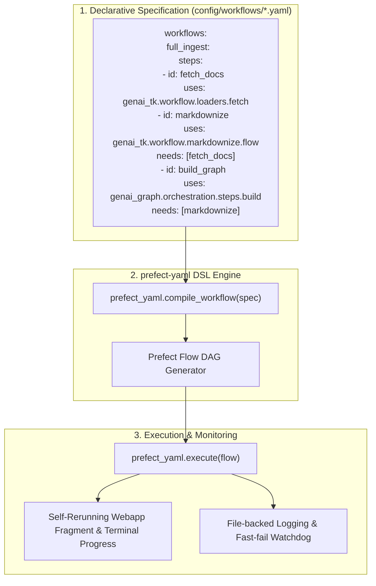

# Design 07: Workflow Engine & Prefect-YAML Integration

## 1. Motivation: Declarative Pipelines Over Hardcoded Scripts

Data ingestion and multi-step AI tasks (e.g. converting a folder of mixed PDFs, Word documents, Git repos, and web links into an enterprise knowledge graph) require robust orchestration:
- **Dependency Management**: Running independent stages in parallel while gating downstream steps on dependencies.
- **Resilience & State**: Automatic retries, step timeouts, and caching of intermediate results.
- **Portability & Separation**: Defining pipeline structure declaratively in human-readable YAML, cleanly decoupled from Python task code.

`genai-tk` delegates its core workflow DSL compilation and execution to the standalone, high-performance [prefect-yaml](https://github.com/tclatos/prefect-yaml) package.



---

## 2. Declarative Workflow DSL

A workflow specification defines steps, inputs, dependencies, and outputs:

```yaml
workflows:
  docgraph_pipeline:
    description: "Multi-source Ingestion and Document Graph Compilation"
    steps:
      - id: ingest_sources
        uses: genai_tk.workflow.ingest.route_and_dispatch
        inputs:
          sources_dir: "${profile.raw_data_dir}"
          routes_config: "config/ingest_routes.yaml"

      - id: build_docgraph
        uses: genai_graph.orchestration.workflow_steps.docgraph_build_step
        needs: [ingest_sources]
        inputs:
          markdown_dir: "${steps.ingest_sources.result.output_dir}"
          graph_db_path: "${profile.graph_db_path}"

workflow_profiles:
  docgraph_pipeline:
    workflow: docgraph_pipeline
    values:
      raw_data_dir: "data/raw/"
      graph_db_path: "data/kg/docgraph.lbug"
```

### Key DSL Features
- **`needs:` Dependency Gating**: Steps run as soon as all prerequisite steps succeed. Steps without mutual dependencies execute concurrently.
- **Variable Interpolation**: Seamless substitution of `${profile.param}` and upstream output `${steps.<step_id>.result.<field>}`.
- **Self-Healing SQLite DB**: The embedded Prefect daemon automatically repairs stale locks or corrupted local database state at startup.

---

## 3. Rule-Selected Ingest Workflows & Routing

Rather than writing custom Python ingestion logic for every new source type, `genai-tk` implements **Orthogonal Document Ingestion** via rule-selected route tables (`config/ingest_routes.yaml`):

```yaml
routes:
  # Git Repositories
  - pattern: "**/.git"
    workflow: ingest_git_repo
    params:
      extract_code: true
      include_commits: false

  # Web URLs
  - pattern: "https?://**"
    workflow: ingest_web_page
    params:
      fetcher: readability

  # Office Documents
  - pattern: "**/*.{docx,pptx,xlsx}"
    workflow: ingest_office_via_pdf
    params:
      converter: docling

  # Raw Markdown / Text
  - pattern: "**/*.{md,txt}"
    workflow: direct_copy
```

### Route Dispatcher Mechanics
1. **Source Discovery**: Ingestion discovers all files, directories, or URLs in the input manifest.
2. **Pathspec Matching**: Each source item is matched against ordered gitignore-style pathspec patterns.
3. **Sub-Workflow Dispatch**: Matched sources are batched by workflow and dispatched as parallel Prefect sub-tasks.
4. **Single-Writer Fan-In**: Once all sources are converted to normalized Markdown, a single atomic build step ingests them into the graph database.

---

## 4. Execution Interfaces

Workflows can be executed and monitored through multiple channels:

```bash
# Dry run to inspect execution plan
uv run cli workflow run docgraph_pipeline --dry-run

# Run full pipeline with progress tracking
uv run cli workflow run docgraph_pipeline
```

Workflows can also be launched interactively via the built-in Streamlit webapp (`just webapp`), which renders step execution progress dynamically as a self-rerunning fragment.

---

## 5. References & Cross-Links

- Standalone Engine: [prefect-yaml repository](https://github.com/tclatos/prefect-yaml)
- User Guides: [docs/workflows.md](../workflows.md), [docs/prefect.md](../prefect.md)
- Previous Design Document: [06_sandbox_and_codeact.md](06_sandbox_and_codeact.md) — Sandbox Isolation & Python CodeAct
- Next Design Document: [08_document_processing_pipeline.md](08_document_processing_pipeline.md) — Document Processing Pipeline & Markdownization
