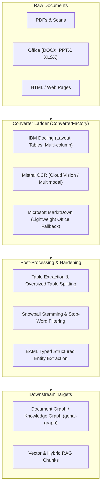

# Design 08: Document Processing Pipeline & Markdownization

## 1. Architectural Challenge: The Garbage-In, Garbage-Out Bottleneck

Downstream LLMs, RAG systems, and knowledge graphs are only as good as the structured text extracted from raw enterprise files:
- Complex PDFs contain multi-column layouts, floating headers, embedded tables, and figures.
- Naive text extractors destroy tabular structure, turning financial tables into disorganized word soup.
- Scanned documents require high-accuracy vision OCR.
- Documents are delivered across dozens of formats: PDF, DOCX, PPTX, XLSX, HTML, scans.

`genai-tk` provides a unified, multi-tiered document processing pipeline (`genai_tk/workflow/markdownize/` and `genai_tk/extra/`).



---

## 2. The Converter Ladder & `ConverterFactory`

Document conversion is driven by `ConverterFactory` (`genai_tk/workflow/markdownize/converter_factory.py`), configured declaratively in `config/markdownize.yaml`:

| Converter | Best Used For | Trade-offs |
|---|---|---|
| **Docling** (IBM) | Complex layouts, embedded tables, reading-order reconstruction | In-process neural extraction; moderate CPU/GPU memory footprint |
| **Mistral OCR** | Scanned documents, handwritten forms, complex graphical PDFs | Cloud vision API; requires API key; pristine Markdown output |
| **MarkItDown** (Microsoft)| Clean Office files (DOCX, PPTX, XLSX) | Ultra-fast local execution; lightweight; simple layout heuristics |

### Converter Profiles
```yaml
# config/markdownize.yaml
profiles:
  fast:
    default_converter: markitdown
    rules:
      - pattern: "**/*.pdf"
        converter: markitdown

  medium:
    default_converter: markitdown
    rules:
      - pattern: "**/*.pdf"
        converter: docling

  best:
    default_converter: docling
    rules:
      - pattern: "**/*.pdf"
        converter: mistral_ocr
```

---

## 3. Tabular Data Preservation & Splitting

Tables carry disproportionate semantic value in enterprise documents (financial reports, balance sheets, specification sheets).

### Table Extraction & Normalization
Tables are detected and rendered as clean GitHub-Flavored Markdown tables. If a table contains merged cells or complex spans, HTML table conversion is applied with strict sanitization.

### Splitting Oversized Tables for RAG
Massive tables (e.g. 500 rows) cannot fit within small RAG chunk windows. `genai-tk` automatically detects oversized tables during chunking:
1. It splits the table rows into logical chunks (e.g. 30 rows).
2. It **re-injects the table header and column names** at the top of every chunk.
3. This ensures that every chunk remains semantically interpretable by the retrieval and embedding models.

---

## 4. High-Throughput Structured Extraction with BAML

For extracting typed entities from documents into database records, `genai-tk` integrates [BAML](https://boundaryml.com/) (`genai_tk/extra/baml/`):
- **Type-Safe Extraction**: Declarative schemas with compile-time Python client generation.
- **Low Latency**: High-throughput parsing without Python runtime JSON deserialization overhead.
- **Self-Correcting**: Automatic retry loops for schema violations.

---

## 5. NLP & Multilingual Linguistic Processing

The NLP subsystem (`genai_tk/extra/nlp/`) handles linguistic normalization:
- **spaCy Models**: Standardized on `en_core_web_md` and `fr_core_news_md` for balanced speed and named entity recognition.
- **Stemming**: Snowball stemmers align full-text search (BM25) tokens between queries and indexed document nodes.
- **Stop Word Filtering**: Domain-specific stop-word removal prevents query bloat in vectorless search.

---

## 6. References & Cross-Links

- Implementation: `genai_tk/workflow/markdownize/`, `genai_tk/extra/nlp/`, `genai_tk/extra/baml/`
- User Guides: [docs/markdownize.md](../markdownize.md), [docs/baml.md](../baml.md), [docs/nlp.md](../nlp.md)
- Previous Design Document: [07_workflow_engine_and_prefect.md](07_workflow_engine_and_prefect.md) — Workflow Engine & Prefect-YAML Integration
- Next Design Document: [09_observability_and_trajectories.md](09_observability_and_trajectories.md) — Observability, Trajectories & Evaluation Architecture
