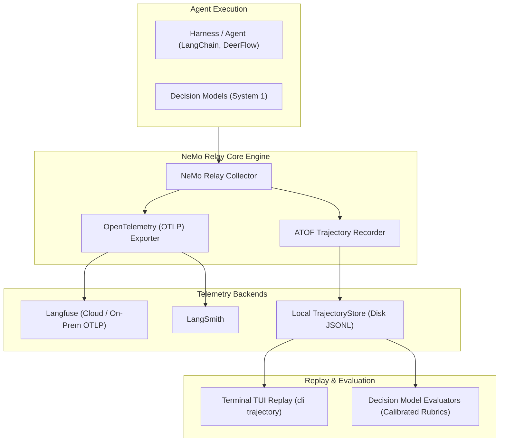

# Design 09: Observability, Trajectories & Evaluation Architecture

## 1. Architectural Challenge: Telemetry & Evaluation Sprawl

As AI agents grow more autonomous, understanding why an agent succeeded or failed becomes paramount:
- **Telemetry Fragmentation**: Different frameworks export spans in proprietary formats (LangSmith vs Langfuse vs raw JSON logs).
- **Evaluation Fragility**: Using full LLMs to judge agent outputs via unstructured prompt templates and regular expressions is slow, expensive, and non-deterministic.
- **Trajectory Blindness**: Debugging multi-turn agents requires replaying the exact sequence of reasoning thoughts, tool calls, and tool outputs step-by-step.

`genai-tk` unifies observability into a cohesive architecture based on **NVIDIA NeMo Relay OTLP telemetry**, **Agent Trajectory Observability Format (ATOF)**, and **Decision Model Evaluators**.



---

## 2. NVIDIA NeMo Relay & OTLP Export to Langfuse

NeMo Relay (`genai_tk/extra/monitoring/nemo_relay_setup.py`) standardizes tracing across all harnesses:
- **OpenTelemetry Standard**: Traces, spans, and metrics follow standard OTLP schemas.
- **Direct Langfuse Integration**: Spans stream directly to Langfuse (cloud or on-prem) via standard environment variables:
  ```bash
  export LANGFUSE_PUBLIC_KEY="..."
  export LANGFUSE_SECRET_KEY="..."
  export LANGFUSE_HOST="https://cloud.langfuse.com"
  ```
- **Context Injection**: Harness run metadata (user ID, session ID, tenant ID, agent profile) is automatically bound to the root trace.

---

## 3. Agent Trajectory Observability Format (ATOF) & `TrajectoryStore`

Agent step sequences are captured in the structured ATOF standard by `TrajectoryStore` (`genai_tk/extra/monitoring/trajectory_store.py`):

```python
class AgentTrajectory(BaseModel):
    session_id: str
    agent_name: str
    start_time: datetime
    end_time: datetime
    steps: list[TrajectoryStep]
    total_tokens: int
    cost_usd: float | None = None


class TrajectoryStep(BaseModel):
    step_index: int
    thought: str | None = None
    tool_name: str | None = None
    tool_args: dict[str, Any] | None = None
    tool_result: str | None = None
    tokens: int = 0
```

Trajectories are stored on disk as append-only JSONL files, enabling zero-overhead recording and offline replay.

---

## 4. Interactive Terminal TUI (`cli trajectory`)

Developers can inspect, search, and replay recorded agent sessions directly inside their terminal without leaving the development environment:

```bash
# Launch interactive terminal TUI
uv run cli trajectory tui

# List recent trajectories
uv run cli trajectory list --limit 10

# Inspect specific session replay
uv run cli trajectory show <session_id>
```

The TUI features:
- Interactive step-by-step cognitive replay (thought -> tool invocation -> tool result -> final answer).
- Token usage and latency breakdowns per step.
- Mouse and keyboard navigation.

---

## 5. Decision Model Evaluators: Retiring Legacy Regex Judges

Historically, benchmarks evaluated agent outputs using slow, expensive LLMs prompted to return formatted text, which was parsed using brittle regular expressions (`openevals`).

`genai-tk` replaces this with **Decision Model Evaluators**:
1. **Calibrated Rubrics**: Using `Score` questions on decision models (e.g. Clef Flash or Laya) to grade answers along an explicit rubric.
2. **Deterministic Trajectory Matching**: Comparing agent tool invocation sequences using `match_trajectory_tools(actual, expected, mode="superset")` for 100% deterministic evaluation.
3. **Speed & Economy**: Grading runs in sub-100ms per item with zero autoregressive token costs.

---

## 6. References & Cross-Links

- Implementation: `genai_tk/extra/monitoring/`, `genai_tk/cli/commands_trajectory.py`, `genai_tk/cli/trajectory_tui.py`
- User Guide: [docs/trajectory.md](../trajectory.md), [docs/monitoring.md](../monitoring.md)
- Previous Design Document: [08_document_processing_pipeline.md](08_document_processing_pipeline.md) — Document Processing Pipeline & Markdownization
