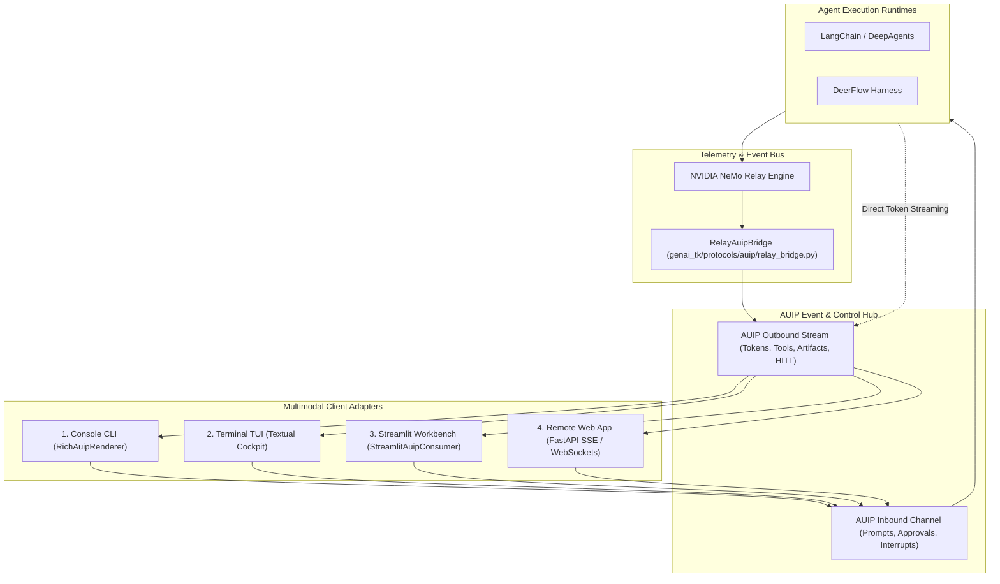

# Design 10: Agent-User Interaction Protocol (AUIP) & Multimodal Frontends

## 1. Architectural Challenge: Decoupling Execution from Presentation

In early autonomous agent systems, execution and presentation were tightly coupled:
- **Terminal Coupling**: Middlewares such as `RichToolCallMiddleware` hooked into tool execution loops to write ANSI escape codes directly to `stdout`.
- **Headless Failure**: In background tasks, batch evaluations (e.g. FinanceBench, OfficeQA), and cloud API servers, hardcoded terminal prints polluted application logs with unrenderable formatting.
- **Framework Fragmentation**: Display logic written for LangChain did not function for DeerFlow or custom graph engines.
- **Unidirectional Display**: Terminal logging middlewares could not support bidirectional Human-in-the-Loop (HITL) scenarios (e.g. asking for user confirmation before executing destructive commands).

`genai-tk` resolves these issues through the **Agent-User Interaction Protocol (AUIP)**, establishing a clean boundary between agent runtimes and presentation frontends.

---

## 2. NeMo Relay as the Universal Lifecycle Tap

Rather than injecting presentation middlewares into agent execution stacks, `genai-tk` leverages **NeMo Relay** ([Design 09: Observability, Trajectories & Evaluation Architecture](09_observability_and_trajectories.md)) as the universal event tap:
- **Hierarchical Scopes**: NeMo Relay captures `Agent` start/stop, `Step` transitions, `LLM` token usage, and `Tool` invocations across both LangChain and DeerFlow.
- **Structured Attributes**: Captures exact tool names, arguments, return values, timing, and errors without touching standard output.
- **Semantic Marks**: Records events like `skill.load`, planning updates, and subagent handoffs.
- **Live Event Listener Bus**: `add_relay_event_listener()` allows `RelayAuipBridge` to tap into live events without altering the execution pipeline.

---

## 3. Formal AUIP Specification

The protocol defines typed Pydantic v2 schemas in `genai_tk.protocols.auip`:

### Outbound Events (Agent -> Client)

| Event Type (`type`) | Payload Model | Purpose |
|---|---|---|
| `stream.token` | `AuipTokenEvent` | Incremental assistant response text chunks |
| `stream.thinking` | `AuipThinkingEvent` | Model internal reasoning / scratchpad trace |
| `phase.change` | `AuipPhaseEvent` | Cognitive node transition (e.g. `planner`, `researcher`) or planning todos |
| `tool.call` | `AuipToolCallEvent` | External tool call invocation details and authorization state |
| `tool.result` | `AuipToolResultEvent` | Captured tool output, execution duration (ms), and status |
| `artifact.emit` | `AuipArtifactEvent` | Rich outputs (code, tables, Mermaid diagrams, file paths) |
| `hitl.request` | `AuipHitlRequestEvent` | Clarification questions or authorization approval requests |
| `telemetry.usage` | `AuipUsageTelemetryEvent` | Turn-level prompt/completion tokens, latency, cost, model ID |
| `turn.error` | `AuipErrorEvent` | Unhandled exceptions or safety violations |
| `turn.end` | `AuipEndEvent` | Turn conclusion signal |

### Inbound Control Messages (Client -> Agent)

| Message Type (`type`) | Payload Model | Purpose |
|---|---|---|
| `user.message` | `AuipUserMessage` | User prompt initiating or continuing a turn |
| `hitl.response` | `AuipHitlResponse` | User reply to a pending `hitl.request` |
| `tool.decision` | `AuipToolDecision` | Human approval, rejection, or amendment of a pending tool call |
| `control.interrupt`| `AuipInterruptControl` | Cancellation, pause, or steering signals |

---

## 4. Multimodal Frontends

AUIP enables a single agent backend to serve diverse client form factors:

### 1. Console CLI (`cli agents run`)
- Consumes `harness.astream_auip()`.
- Uses `RichAuipRenderer` (`genai_tk/protocols/auip/renderers/rich_console.py`).
- Renders live spinners for tool invocations, one-line summary briefs with duration, loaded skill badges, and formatted Markdown answers.

### 2. Terminal TUI (`cli agents tui`)
- Textual-based split-screen cockpit.
- Left pane displays the live nested cognitive step tree with collapsible tool parameter/result inspectors.
- Right pane displays streaming conversational markdown and interactive approval prompts.

### 3. Streamlit Webapp (`genai_tk/webapp`)
- Driven by `stream_harness_turn()` in `genai_tk/webapp/ui_components/harness_workbench.py`.
- Maps AUIP events to native `st.status()`, `st.chat_message()`, `st.expander()`, and interactive code/Mermaid artifact visualizers.

### 4. Remote Web App Gateway (SSE / WebSockets)
- Headless FastAPI service exposing `POST /api/v1/sessions/stream` emitting standard W3C Server-Sent Events (`text/event-stream`).
- Enables React, Vue, Next.js, Electron, and corporate portals to interact with `genai-tk` agents using standard web hooks.
- Detailed implementation patterns and client code are documented in the skill `agent-user-interaction-protocol`.

---

## 5. Deprecation & Retirement of `RichToolCallMiddleware`

`RichToolCallMiddleware` in `genai_tk/agents/langchain/middleware/rich_middleware.py` is formally deprecated:
- Removed from default configurations (`config/examples/agents/defaults.yaml`, `config/agents/langchain/browser.yaml`).
- Removed from sibling projects (`wiki`, `genai-graph`, `rfq-analyst`, `ekg-atos`).
- Retained as a backward-compatibility stub emitting `DeprecationWarning` if referenced by legacy third-party configurations.
