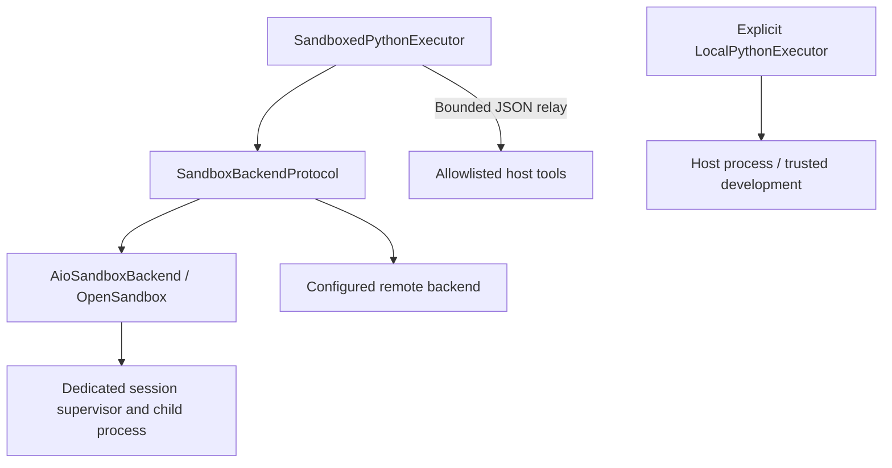

# Sandbox Support & Execution Architecture

Container and cloud sandboxes provide an operating-system boundary for agent
code. The boundary still depends on runtime configuration, mounts, credentials,
network access, and the host tools exposed to the agent. Local execution provides
no such isolation.

All agent frameworks in **genai-tk** (LangChain, DeepAgents, and DeerFlow) support sandboxes through a unified 3-layer architecture and shared configuration.

---

## 1. Architectural Layers: Decoupling Sandboxes, Protocols, and Executors

The sandbox subsystem is structured into three clean, decoupled layers:



### Layer 1: Isolation Runtimes (Infrastructure)
Where execution physically occurs:
* **Local Host (`local`)**: Runs commands directly in host processes. Fast, zero-overhead, suitable for development and trusted tasks.
* **OpenSandbox Docker (`docker` / `aio_sandbox`)**: The default all-in-one local container (`ghcr.io/agent-infra/sandbox:latest`, ~13GB) including Chromium with CDP + VNC, Python 3.11 with data science packages, Node.js, and an in-container `execd` daemon.
* **Cloud Sandboxes (`e2b`, `modal`, `daytona`)**: Managed remote microVMs or container endpoints for elastic scaling and zero local Docker dependencies.

### Layer 2: Generic Protocol (`SandboxBackendProtocol`)
Defined by `deepagents.backends.protocol.SandboxBackendProtocol`. It specifies a standard async contract:
* `aexecute(command, timeout)` — run shell commands
* `aread(path, offset, limit)` / `awrite(path, content)` / `aedit(path, old, new)` — file I/O
* `agrep_raw(pattern, path)` / `aglob_info(pattern, path)` — search and discovery
* `aupload_files(...)` / `adownload_files(...)` — bulk file transfer

> **Key Insight:** `SandboxBackendProtocol` is **not Python-specific**; it is a general runtime environment abstraction.

### Layer 3: Python Execution Actions (`BasePythonExecutor`)
How agents execute stateful Python code blocks:
* **`LocalPythonExecutor`**: In-process AST interpreter with import allow-lists and operation limits, for trusted development only. Its timeout cannot terminate a running host thread.
* **`SandboxedPythonExecutor`** (aliased to `DockerPythonExecutor`): Maintains a stateful child process in a dedicated sandbox. Host tool requests and results travel over the existing sandbox command transport as bounded JSON; the executor opens no host listener. The default factory mode is `docker`; `auto` and `sandbox` are fail-closed aliases, and `local` requires explicit opt-in.

---

## 2. Decision Matrix: When to Use Which Runtime

| Runtime | Isolation Level | Cold Start | Data Science Libs | Browser & VNC | Best For |
| :--- | :--- | :--- | :--- | :--- | :--- |
| **`local`** | None; same host privileges | No container startup | Host-installed | Host Playwright | Trusted local development and tests |
| **`docker` (OpenSandbox)** | Container boundary, subject to runtime policy | Image/runtime dependent | Image-dependent | Image-dependent | Isolated execution with restricted resources and capabilities |
| **`e2b` / `modal`** | Cloud MicroVM | ~2-4s | Custom template | Cloud headless | Production cloud deployments without local Docker daemon |

---

## 3. Extensibility: `SandboxBackendFactory`

New sandbox technologies (such as E2B, Modal, Daytona, or custom container runtimes) can be introduced **without modifying agent profiles or core harness code**.

### Registering via YAML Configuration

Declare the qualified Python class name in `config/sandbox.yaml` under `sandbox.backends`:

```yaml
sandbox:
  default: docker

  # Custom and pluggable backends:
  backends:
    docker:
      class: "genai_tk.agents.sandbox.aio_backend.AioSandboxBackend"
    local:
      class: "deepagents.backends.local_shell.LocalShellBackend"
    e2b:
      class: "my_package.sandboxes.e2b:E2bSandboxBackend"
    modal:
      class: "my_package.sandboxes.modal:ModalSandboxBackend"
```

### Programmatic Resolution & Instantiation

```python
from genai_tk.agents.sandbox import SandboxBackendFactory

# Create any registered backend:
backend = SandboxBackendFactory.create("docker")
# Or create custom cloud backend:
# e2b_backend = SandboxBackendFactory.create("e2b", api_key="sk-...")
```

---

## 4. Lifecycle & Session Management (`SandboxManager`)

`SandboxManager` provides a singleton for harnesses that deliberately reuse a
backend across turns within one trust boundary:

```python
from genai_tk.agents.sandbox import SandboxManager

# Get or lazily start the shared session backend
backend = await SandboxManager.aget_shared_backend()
```

The Python executor does **not** acquire this shared backend implicitly. Its
default constructor owns a new backend, retaining it only for that executor's
session and omitting configured `env_vars` and `volumes`. Supplying `backend=` is
an explicit caller-owned mode that can grant those capabilities; separate workers
inside the same container do not provide tenant isolation.

Use `await executor.aclose()` (or synchronous `close()`) to release an owned
backend. Worker timeouts and transport failures invalidate the executor and retire
its owned container. Cleanup failures are reported, not treated as a successful
stop. For a caller-owned backend, worker cleanup is attempted, but the caller must
retire the entire backend after a timeout to stop detached child processes. An
invalidated executor cannot be reset or reused.

Default Python executors set `AioSandboxBackend.stop_server_on_close=False`:
container cleanup leaves the shared OpenSandbox daemon available to peer
containers, even when that executor started the daemon. Stop it explicitly with
`uv run cli sandbox stop` when it is no longer needed. General
`AioSandboxBackend` instances retain `stop_server_on_close=True` by default for
existing manager behavior; callers sharing the daemon should select `False`.

For generic `AioSandboxBackend.aexecute(command, timeout=...)`, expiry or caller
cancellation retires the whole backend so the shell command cannot silently
continue. A control-plane failure during termination is surfaced for cleanup retry.

---

## 5. OpenSandbox Setup & CLI Commands

When using the `docker` backend, genai-tk orchestrates **Alibaba OpenSandbox** and the `agent-infra/sandbox` image.

### Installation

```bash
# Install optional sandbox dependencies
uv sync --extra harnessing
# Or during project initialization
uv run cli init --with-sandbox
```

### CLI Management

```bash
uv run cli sandbox start   # Start opensandbox-server daemon in background
uv run cli sandbox pull    # Pre-pull the configured Docker image
uv run cli sandbox status  # Verify daemon health and image availability
uv run cli sandbox stop    # Stop background daemon
```

### Running Agents with Sandboxes

```bash
# Run trusted shell tools on the host (does not change the Python tool's executor_type)
uv run cli agents run chat --sandbox local "Compute compound interest"

# Run with isolated Docker sandbox (with stateful NumPy / Pandas)
uv run cli agents run research --sandbox docker "Analyze financial tables"

# Interactive multi-turn chat with container reuse
uv run cli agents run "Browser Agent" --sandbox docker --chat
```

### Live VNC Viewer (Browser Agents)

When running browser agents in Docker, observe actions live in your browser:
```
http://localhost:8080/vnc/index.html?autoconnect=true
```

---

## 6. Shared Configuration Reference

See [config/examples/sandbox.yaml](../config/examples/sandbox.yaml). The generic
harness default and the Python executor's `executor_type` are distinct settings.
Changing `sandbox.default` to `local` does not authorize Python executor fallback.

```yaml
sandbox:
  default: local

  # Docker-specific OpenSandbox settings:
  docker:
    aio:
      image: "ghcr.io/agent-infra/sandbox:latest"
      opensandbox_server_url: "http://localhost:8080"
      startup_timeout: 60.0
      work_dir: "/home/user"
      cpu_limit: 1.0
      memory_limit_mb: 2048
      max_command_response_bytes: 16777216
      env_vars:
        DEBUG: "0"
      # Skill directories are mounted read-only automatically to /mnt/skills
      volumes: []

  # Cloud Sandbox Settings (Optional):
  e2b:
    api_key: ${oc.env:E2B_API_KEY,null}
    timeout: 300
```

The AIO CPU and memory settings are sent to OpenSandbox when it creates the
container. The generated local server configuration also sets `pids_limit=256`,
`no_new_privileges=true`, and the core-dump limit. An externally managed
OpenSandbox server must enforce equivalent process and privilege restrictions;
the client settings alone cannot prove the remote host's policy.

AIO command responses also have a host-side `max_command_response_bytes` limit
(16 MiB by default). The HTTP transport checks bytes before the SDK parses SSE
frames, including an unterminated frame, and rejects compressed command bodies
to prevent expansion before that check. A limit violation closes the response
and retires the backend; it is never retried. This counts the entire command
response, including SSE framing, rather than only the final Python value.
File-transfer responses retain their existing behavior. This limit requires
`opensandbox>=1.1.0`; older SDKs without configurable transports fail closed with
upgrade guidance. It does not constrain other sandbox HTTP endpoints or replace
container, network, and capability policy.

## 7. Python worker limits and deployment boundary

The Python worker uses an authenticated loopback supervisor and a child process
with a separate process group. Requests have a 1 MiB size ceiling, log capture
is bounded during execution, and a wall deadline terminates the child. The
worker's `memory_limit_mb` (default 1024) is a supplementary Linux address-space
limit; the container memory limit applies to the whole container. CPU and process
limits must also be enforced at the container runtime boundary.

Code in a container may use its installed libraries and accessible files. The
local AST allowlist is not applied to container code. Default Python sessions
omit configured environment variables and host mounts. When explicitly supplying
a backend, restrict mounted paths, prefer read-only mounts, and keep host
credentials out of the worker. Network egress remains deployment-dependent and
must be restricted separately. The registered host-tool allowlist is a separate
capability boundary: those tools run with their host privileges and must validate
inputs and implement their own authorization.

A deadline cannot undo a completed tool action. Awaiting a synchronous tool may
time out while that tool continues running. Tool requests are not automatically
retried; callers must resolve an uncertain outcome before retrying.

See [CodeAct execution and migration guidance](codeact.md#execution-and-trust-boundaries)
and [the implementation design](design/06_sandbox_and_codeact.md).

