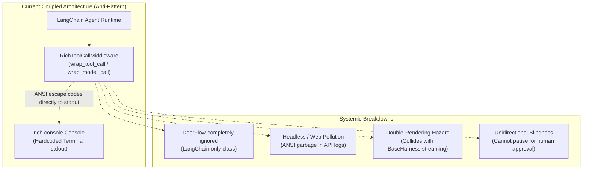
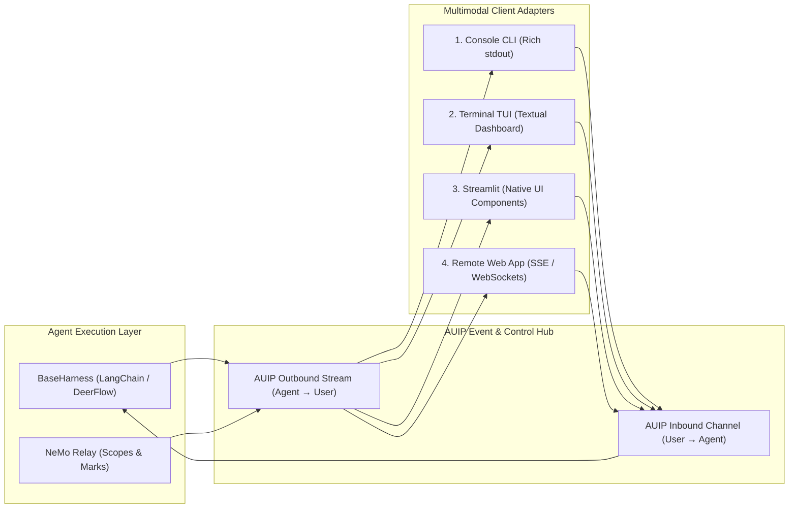
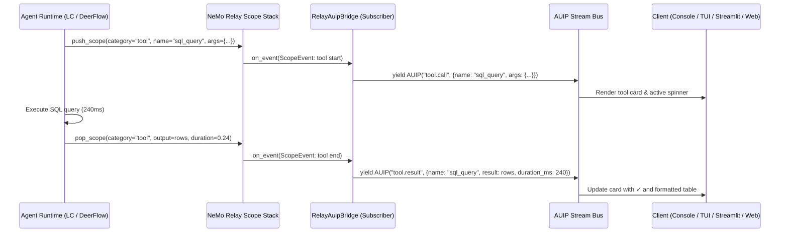
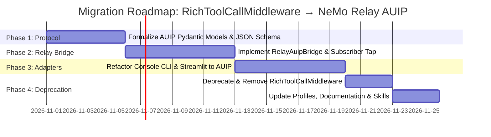

# Architectural Study: Retiring RichToolCallMiddleware & Connecting NeMo Relay to the Agent-User Interaction Protocol (AUIP)

**Status:** Proposed Architecture & Feasibility Study  
**Date:** 2026-10-15  
**Target Systems:** `genai_tk.agents.harness`, `genai_tk.agents.langchain.middleware`, `genai_tk.extra.monitoring`, `genai_tk.webapp`, CLI & Web Frontends  
**Related Documents:**
- [Design 05: Autonomous Agent Harness & Cross-Harness Middleware](../design/05_agent_harness_and_middleware.md)
- [Design 09: Observability, Trajectories & Evaluation Architecture](../design/09_observability_and_trajectories.md)
- [Harness & Canonical Event Model](../harness.md)
- [NeMo Relay Trajectory Specifications (Historical)](agent_trajectory_nemo_relay_spec.md)

---

## 1. Executive Summary & Verdict

### The Core Questions
1. **Do we still need `RichToolCallMiddleware`?**  
   **No.** `RichToolCallMiddleware` is an architectural relic and anti-pattern. It violates separation of concerns by coupling agent execution loops directly to terminal stdout via `rich.console.Console`. It is locked exclusively to LangChain, pollutes server logs in headless and web deployments, causes duplicate rendering when paired with harness streaming, and cannot support bidirectional human-in-the-loop (HITL) interactions.

2. **Can it be replaced by NeMo Relay?**  
   **Yes, for execution observability and event capture.** NeMo Relay already intercepts model calls, tool executions, and semantic marks across *both* LangChain and DeerFlow harnesses. It captures tool names, arguments, return values, timing, token counts, and exceptions without any terminal coupling.

3. **Can we connect NeMo Relay to an Agent-User Interaction Protocol (AUIP) to drive Console, TUI, Streamlit, and Remote Web Apps?**  
   **Yes.** By positioning NeMo Relay as the unified lifecycle and event emitter feeding a formalized **Agent-User Interaction Protocol (AUIP)**, we can decouple execution from presentation entirely. One shared event bus drives:
   - **Console CLI**: Rich text and live spinners for fast terminal chat (`cli agents run`).
   - **Terminal TUI**: Interactive full-screen Textual cockpit (`cli agents tui`) with step trees and collapsible tool inspections.
   - **Streamlit Webapp**: Native reactive widgets (`st.chat_message`, `st.status`, `st.expander`) replacing ad-hoc callback handlers.
   - **Remote Classical Web App**: Standardized Server-Sent Events (SSE) or WebSockets streaming structured JSON to React, Vue, or enterprise portals.

---

## 2. Forensic Analysis: Why `RichToolCallMiddleware` Must Be Retired

`RichToolCallMiddleware` was introduced early in `genai-tk` to provide rich terminal visual feedback for tool calls and planning steps. While effective for simple CLI scripts, modern multi-harness requirements have exposed five fatal architectural limitations:



### Breakdown of Current Failures

1. **Severe Violation of Separation of Concerns**:
   Execution middleware must govern agent state, security policies (PII redaction, sensitivity routing), or telemetry. Embedding presentation rendering (`self._console.print(Panel(...))`) inside `AgentMiddleware` binds the runtime directly to a local terminal screen.
2. **Framework Siloing (LangChain-Only)**:
   `RichToolCallMiddleware` inherits from `langchain.agents.middleware.AgentMiddleware`. DeerFlow agents cannot use it. If a developer runs a DeerFlow profile, terminal formatting behaves completely differently because display logic was never generalized.
3. **Log Pollution in Headless & Cloud Deployments**:
   When agents execute inside Prefect workflow orchestrators, automated benchmark evaluation suites (FinanceBench / OfficeQA), REST APIs, or background workers, `RichToolCallMiddleware` continues writing ANSI color codes to standard output, bloating logs and breaking log parsers.
4. **Collision with Canonical Harness Streaming**:
   `BaseHarness.astream()` already emits canonical `ToolCallEvent`, `ToolResultEvent`, `ThinkingEvent`, and `TokenEvent`. In `cli agents run --chat`, `astream_turn` in [genai_tk/agents/harness/chat_repl.py](../../genai_tk/agents/harness/chat_repl.py) listens to these events and prints tool invocations to the console. When `RichToolCallMiddleware` is enabled in the agent's YAML profile, tool calls are printed **twice**: once by the middleware, and once by the harness renderer!
5. **No Bidirectional Interaction (Human-in-the-Loop)**:
   `RichToolCallMiddleware` only prints after an action has taken place. It cannot ask: *"The agent wants to run `rm -rf /tmp/build`. Do you approve? [y/N]"*.

---

## 3. The Role of NeMo Relay: Telemetry Backbone vs. Interaction Protocol

To design the replacement cleanly, we must clarify what NeMo Relay is and what it is not.

### What NeMo Relay Provides
NeMo Relay is NVIDIA's open-source observability framework for AI agent trajectories. In `genai-tk`, it already serves as the core telemetry foundation ([Design 09: Observability, Trajectories & Evaluation Architecture](../design/09_observability_and_trajectories.md)):
- **Hierarchical Scopes**: Automatically manages execution scopes (`Agent` -> `Step` -> `LLM` -> `Tool`).
- **Standardized Attributes**: Captures tool names, structured JSON arguments, return outputs, start/end timestamps, latency, token counts, and error states.
- **Semantic Marks**: Emits domain events such as `skill.load`, planning changes, and subagent handoffs.
- **Pub/Sub Subscriber Bus**: `nemo_relay.subscribers.register("name", callback)` receives typed events synchronously or asynchronously for every lifecycle transition across *all* frameworks.

### The Architectural Distinction
NeMo Relay is an **observability and telemetry bus** (Agent -> Observers). It is not by itself an interactive frontend protocol. It does not manage user input sessions, client connection state, or bidirectional control signals.

Therefore, the target architecture requires two collaborating tiers:
1. **Telemetry & Lifecycle Tap (NeMo Relay)**: Emits engine-agnostic scopes and marks from whichever harness is running (LangChain, DeepAgents, DeerFlow).
2. **Agent-User Interaction Protocol (AUIP)**: Translates Relay events and harness streams into a standardized bidirectional contract consumed by user interfaces.

---

## 4. Formal Specification: Agent-User Interaction Protocol (AUIP)

The **Agent-User Interaction Protocol (AUIP)** is a lightweight, JSON-serializable, transport-agnostic message protocol governing interaction between an agent runtime and human-facing frontends.



### 4.1 Outbound Message Types (Agent -> Client)

All outbound messages are structured JSON payloads with a common envelope:

```json
{
  "protocol": "auip/1.0",
  "id": "evt_0199e8f4_a1b2",
  "timestamp": "2026-10-15T21:14:02.120Z",
  "session_id": "sess_default_01",
  "turn_id": "turn_04",
  "type": "<event_type>",
  "data": { ... }
}
```

| Event Type (`type`) | Payload Description | Client Rendering Target |
|---|---|---|
| `stream.token` | Incremental text chunk of final assistant answer | Word-by-word streaming markdown |
| `stream.thinking` | Reasoning trace / thinking scratchpad content | Collapsible "Thinking..." block |
| `phase.change` | Graph node transition (e.g. `planner`, `researcher`, `coder`) | Stepper / Breadcrumbs / Progress indicator |
| `tool.call` | Tool name, call ID, input arguments, authorization level | Tool execution card / spinner / parameter table |
| `tool.result` | Call ID, stdout/result, execution duration (ms), status | Formatted output panel / error banner |
| `artifact.emit` | Code file, table, chart, Mermaid diagram, or screenshot | Interactive code editor, SVG render, file download |
| `hitl.request` | Question, prompt, choice list, or tool approval request | Interactive form / confirmation modal |
| `telemetry.usage` | Prompt tokens, completion tokens, latency, cost USD | Status bar / cost widget |
| `turn.end` | Completion status (`success`, `interrupted`, `error`) | Finalize turn UI state |

### 4.2 Inbound Control Messages (Client -> Agent)

| Message Type | Payload Description | Purpose |
|---|---|---|
| `user.message` | Prompt text, attachments, active thread ID | Start new turn or submit follow-up |
| `hitl.response` | Answer text, selected option, or form values | Resume agent paused on `hitl.request` |
| `tool.decision` | `approve`, `reject`, or modified arguments | Security gate for sensitive tool calls |
| `control.interrupt`| Reason: `cancel`, `pause`, or `steer` | Abort or redirect in-flight execution |

---

## 5. Connecting NeMo Relay to AUIP: The Unified Event Bridge

Instead of having disparate callback handlers (`BaseCallbackHandler` for LangChain, `StreamEvent` for DeerFlow, and `RichToolCallMiddleware` for terminal display), a single **`RelayAuipSubscriber`** taps into NeMo Relay:



### Event Translation Mapping

| NeMo Relay Event | Scope / Mark Details | Translated AUIP Event |
|---|---|---|
| `ScopeEvent (start)` | `category == "agent"` | `phase.change (node=scope.name)` |
| `ScopeEvent (start)` | `category == "tool"` | `tool.call (tool_name, args, call_id)` |
| `ScopeEvent (end)` | `category == "tool"` | `tool.result (tool_name, output, duration, status)` |
| `ScopeEvent (end)` | `category == "llm"` | `telemetry.usage (tokens, model, cost)` |
| `MarkEvent` | `name == "skill.load"` | `artifact.emit (type="skill", name=data.skill_name)` |
| `MarkEvent` | `name == "plan.update"` | `phase.change (state=data.todos)` |
| `MarkEvent` | `name == "hitl.request"` | `hitl.request (question, context, schema)` |

### Token Streaming Harmony
While NeMo Relay scopes capture complete LLM requests and responses, high-frequency word-by-word streaming is multiplexed directly from the harness's native token stream (`on_chat_model_stream` or generator chunk) as `stream.token` events. The AUIP event hub multiplexes both streams into one coherent channel without duplication.

---

## 6. Multi-Frontend Implementations via AUIP

With `RichToolCallMiddleware` eliminated and AUIP established, each client consumes the exact same protocol through a specialized adapter.

```
                            ┌──► 1. Console CLI (RichAuipRenderer)
                            │
Agent Runtime ──► NeMo Relay ──► AUIP Bus ──► 2. Terminal TUI (TextualAuipApp)
                            │
                            ├──► 3. Streamlit (StreamlitAuipConsumer)
                            │
                            └──► 4. Remote Web App (FastAPI SSE / WebSockets)
```

### 1. Console CLI (`cli agents run`)
- **Adapter**: `RichAuipRenderer` in [genai_tk/agents/harness/chat_repl.py](../../genai_tk/agents/harness/chat_repl.py).
- **Behavior**:
  - `stream.token`: Streams directly to terminal or renders clean Markdown on turn completion.
  - `tool.call`: Displays a neat cyan spinner `[tool] sql_query({"query": "SELECT ..."})`.
  - `tool.result`: Displays timing and concise smart summaries via `summarize_tool_result()`.
  - `artifact.emit`: Renders syntax-highlighted code panels or table summaries.
- **Advantage**: Zero coupling inside the agent runtime; the agent profile YAML is completely clean of UI middleware.

### 2. Terminal TUI (`cli agents tui`)
- **Adapter**: Full-screen terminal dashboard powered by Textual or Rich Live layouts.
- **Layout**:
  - **Left Pane (Live Trajectory Tree)**: Displays the nested hierarchy of subagents, active phases (Planner -> Researcher -> Coder), and expandable tool call cards with raw JSON parameters.
  - **Right Pane (Chat & Markdown View)**: Live streaming markdown text, formatted tables, and inline Mermaid diagrams.
  - **Bottom Bar**: Real-time token counter, elapsed seconds, active LLM model ID, and HITL prompt bar.

### 3. Streamlit Webapp (`genai_tk/webapp`)
- **Adapter**: `StreamlitAuipConsumer` replacing [StreamlitStatusCallbackHandler](../../genai_tk/webapp/ui_components/streamlit_chat.py) and hardcoded event loops in [harness_workbench.py](../../genai_tk/webapp/ui_components/harness_workbench.py).
- **Behavior**:
  - `tool.call` & `tool.result`: Rendered into native `st.status()` containers with expandable details.
  - `artifact.emit`: Rendered as interactive code editors (`st.code`), dataframes (`st.dataframe`), or Mermaid SVGs.
  - `hitl.request`: Pauses execution and renders `st.radio()` / `st.text_input()` with a submit button, seamlessly resuming on submit.
- **Advantage**: Identical behavior for LangChain and DeerFlow agents with zero framework-specific callback boilerplate.

### 4. Remote Classical Web App (FastAPI / SSE / WebSockets)
- **Adapter**: `AuipSseGateway` / `AuipWebSocketGateway`.
- **Endpoints**:
  - `POST /api/v1/sessions/{id}/turns` (sends user prompt).
  - `GET /api/v1/sessions/{id}/stream` (SSE stream of AUIP JSON packets).
  - `POST /api/v1/sessions/{id}/hitl` (submits user approvals or clarification answers).
- **Client Integration**:
  - Frontend frameworks (React, Vue, Svelte, Next.js) consume standard SSE events using standard EventSource or AI SDK integrations (Vercel AI SDK compatible).
  - Enterprise web applications can render custom React tool widgets (e.g. interactive maps for location tools, Diff-viewers for file edits).

---

## 7. Comparative Assessment Matrix

| Dimension | Current: `RichToolCallMiddleware` | Proposed: NeMo Relay + AUIP |
|---|---|---|
| **Separation of Concerns** | ❌ Hardcoded terminal prints inside execution middleware | ✅ Pure telemetry & protocol; rendering decoupled in client adapters |
| **Harness Agnosticism** | ❌ LangChain only; DeerFlow unsupported | ✅ Universal across LangChain, DeepAgents, DeerFlow, and Custom |
| **Headless / Evals / Cloud** | ❌ Pollutes stdout with ANSI escape codes | ✅ Clean headless execution; events route to JSONL/Langfuse/APIs |
| **Interactive Frontends** | ❌ Console stdout only | ✅ Uniform support for Console, TUI, Streamlit, and Remote Web |
| **Human-in-the-Loop (HITL)** | ❌ Read-only; cannot pause for authorization | ✅ Full bidirectional approval/clarification semantics |
| **Event Replay & Auditing** | ❌ Ephemeral screen prints; lost upon terminal exit | ✅ Recorded in ATOF TrajectoryStore; replayable in TUI/benchmarks |
| **Configuration Cleanliness**| ❌ Boilerplate middleware references in agent YAML profiles | ✅ Clean profile declarations without presentation concerns |

---

## 8. Migration & Implementation Roadmap

When approved for implementation, the transition can proceed safely in four surgical phases without breaking existing workflows:



### Phase 1: Protocol Formalization (`genai_tk/protocol/auip/`)
- Evolve existing [HarnessEvent](../../genai_tk/agents/harness/events.py) models into the complete AUIP schema.
- Ensure strict Pydantic v2 validation and JSON serialization.

### Phase 2: Relay AUIP Bridge (`genai_tk/extra/monitoring/relay_auip_bridge.py`)
- Register a dedicated NeMo Relay subscriber converting `ScopeEvent` and `MarkEvent` to AUIP events.
- Multiplex real-time token chunks with structured scope lifecycle events.

### Phase 3: Multi-Frontend Adapter Refactoring
- Update [chat_repl.py](../../genai_tk/agents/harness/chat_repl.py) to use `RichAuipRenderer`.
- Update [harness_workbench.py](../../genai_tk/webapp/ui_components/harness_workbench.py) to consume AUIP events directly.
- Add an experimental FastAPI SSE router for remote web apps.

### Phase 4: Deprecation & Clean Up
- Remove `RichToolCallMiddleware` from `config/agents/langchain/*.yaml` and `agent_defaults`.
- Mark `RichToolCallMiddleware` deprecated with a warning redirecting to the harness CLI.
- Update `docs/agents.md`, `docs/harness.md`, and relevant skills.

---

## 9. Conclusion

Retiring `RichToolCallMiddleware` is not merely a cleanup of an old middleware class; it is the catalyst for unlocking a **universal, multi-frontend architecture** for `genai-tk`. 

By letting **NeMo Relay** do what it does best (cross-harness lifecycle capture) and piping its events into a standardized **Agent-User Interaction Protocol (AUIP)**, `genai-tk` achieves true separation of concerns: any agent can be inspected, steered, and experienced with rich fidelity in the Terminal, in a full-screen TUI, in Streamlit, or in a modern web portal.
